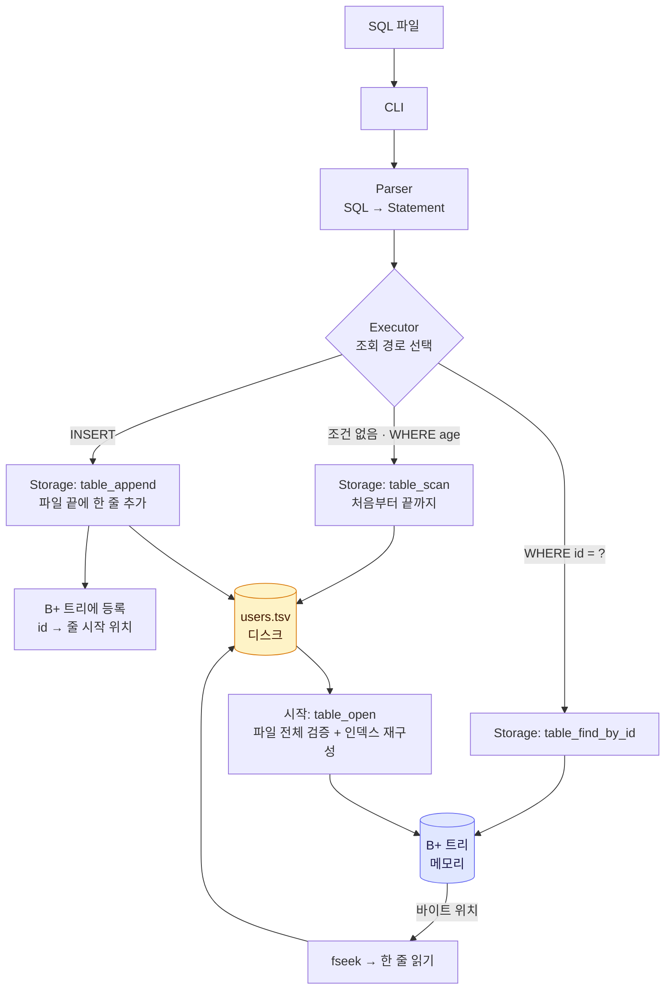

# Phase 2 개발 명세 — B+ 트리 인덱스

## 목표와 확정 범위

- [과제 요구] 메모리 기반 B+ 트리를 구현한다. 실제 DBMS의 디스크 기반 B+ 트리를 단순화한 형태다.
- [과제 요구] 레코드가 추가되면 ID를 자동 부여하고, 그 ID를 B+ 트리에 인덱스로 등록한다.
- [과제 요구] `WHERE id = ?` 조회는 B+ 트리 인덱스를 사용한다.
- [과제 요구] 1,000,000건 이상을 INSERT한 뒤 ID 조회(인덱스)와 다른 필드 조회(선형 탐색)의 속도를 비교한다.
- [과제 요구] Phase 1 SQL 처리기를 그대로 사용해 연결한다.
- [확정: 사용자, 2026-11-15] 추가 기능: id 범위 조회, EXPLAIN 실행 계획.
- [확정: 사용자, 2026-11-15] 기능 하나씩 구현하고, 사용자가 실행·예측·수정해 본 뒤 진행을 요청하면 다음 기능으로 넘어간다.
- [변경: 사용자, 2026-11-16] P2-02~P2-05는 한 단위 구현 후 테스트·메모리 검사로 검증하고, 통과하면 바로 커밋한 뒤 다음 단위로 간다. 학습은 사용자의 별도 노트로 진행하며 구현의 진행 조건이 아니다.

## 최종 결과 — Phase 2가 끝나면 보이는 것

아래는 완성 시점의 모습이다. 수치는 형식 예시이며 실제 값은 P2-04에서 측정해 benchmark.md(P2-04에서 생성)에 기록한다.

```text
$ python3 tools/gen_sql.py 1000000 > build/million.sql        # 100만 건 INSERT 문 생성
$ build/minidb --data-dir bench build/million.sql > /dev/null  # Phase 1 처리기로 그대로 실행

$ build/minidb --data-dir bench --timing q.sql
EXPLAIN SELECT * FROM users WHERE id = 777777;
INDEX LOOKUP (id = 777777, B+ 트리 높이 4)          ← P2-02 형식(확정)
EXPLAIN SELECT * FROM users WHERE age = 30;
FULL SCAN (age = 30, 전체 행 수 1000000)            ← P2-02 형식(확정)
SELECT * FROM users WHERE id BETWEEN 10 AND 12;
  → INDEX RANGE SCAN (리프 연결을 따라 3건)          ← P2-03에서 확정
  조회 시간 0.00x ms / 2xx ms                         ← 실제 실행 측정값, --timing 형식은 P2-04에서 확정
```

| 조회 | 경로 | 읽는 양 | 시간 복잡도 |
|---|---|---|---|
| `WHERE id = ?` | B+ 트리 → 바이트 위치 → 한 줄 | 노드 높이 수 + 1줄 | O(log N) |
| `WHERE id BETWEEN a AND b` | B+ 트리로 시작 리프 → 리프 연결 따라감 | 결과 K건 | O(log N + K) |
| `WHERE age = ?` | 파일 전체 순차 읽기 | N줄 전부 | O(N) |

## 전체 데이터 흐름



**인덱스는 메모리에, 데이터는 파일에 있다.** 프로그램이 끝나면 트리는 사라지고, 다음 실행의 `table_open`이 파일을 한 번 읽어 트리를 다시 만든다. 그래서 인덱스는 언제나 파일에서 다시 만들 수 있는 "파생 데이터"다.

## 입출력 계약 (Phase 1 대비 변경점)

| 항목 | Phase 1 | Phase 2 |
|---|---|---|
| `WHERE id = 값` | 선형 탐색. 일치 뒤에도 파일 끝까지 읽음 | **B+ 트리로 위치를 찾아 그 한 줄만 읽음** (P2-01) |
| `WHERE age = 값`, 조건 없음 | 선형 탐색 | 변경 없음 |
| 파일 손상 검출 | 시작 시 전체 검증 + 조회 시 전체 읽기 | 시작 시 전체 검증(인덱스 구축과 함께). id 조회는 읽은 줄의 id를 다시 확인해, 다르면 "인덱스와 데이터 파일이 일치하지 않습니다" 오류 |
| `EXPLAIN SELECT ...` | 없음 | 실행 계획 한 줄 출력, 조회는 실행하지 않음 (P2-02, 아래 "EXPLAIN 계약") |
| `WHERE id BETWEEN a AND b`, `id <`, `<=`, `>`, `>=` | 오류 | 인덱스 범위 조회 (P2-03, 문법·경계는 그 기능에서 확정). age는 계속 `=`만 |
| 대량 데이터 생성 · 시간 측정 | 없음 | `tools/gen_sql.py`, `--timing` 등 (P2-04에서 확정) |

### EXPLAIN 계약 (P2-02 확정, 2026-11-16 사용자)

```text
EXPLAIN SELECT * FROM users [ WHERE id|age = 정수 ] ;     -- 키워드 대소문자 무시, EXPLAIN 뒤에는 SELECT만
```

| 조건 | stdout (한 줄, 헤더 없음) |
|---|---|
| `WHERE id = 3` | `INDEX LOOKUP (id = 3, B+ 트리 높이 2)` |
| `WHERE age = 25` | `FULL SCAN (age = 25, 전체 행 수 5)` |
| 조건 없음 | `FULL SCAN (조건 없음, 전체 행 수 5)` |

- **계획만 만들고 조회는 실행하지 않는다.** 행·`id name age` 헤더를 출력하지 않고 파일도 바꾸지 않는다.
- 괄호 안 숫자는 **계획 시점 통계**다. 트리 높이 = id 조회 한 번이 방문할 노드 수, 전체 행 수 = 선형 탐색이 읽을 줄 수. 실제 실행 측정값(걸린 시간 등)이 아니며, 측정값은 P2-04에서 따로 표시한다.
- 통계는 메모리의 인덱스에서 얻는다. 시작 시 `table_open`이 파일 전체를 읽어 인덱스를 만든 뒤로는, 계획을 만들면서 파일을 **추가로** 읽지 않는다.
- 경로는 조건의 종류만으로 정한다. 없는 id, 음수 id도 `INDEX LOOKUP`이다(키 존재 여부는 실행해야 안다).
- EXPLAIN이 보여 주는 경로와 같은 문장을 실제로 실행할 때의 경로는 항상 같다(경로를 고르는 곳이 한 곳).
- 오류: `EXPLAIN INSERT ...` → "EXPLAIN은 SELECT 문에만 사용할 수 있습니다", `EXPLAIN` 뒤에 SELECT가 아닌 것 → 구문 오류. 그 밖의 오류 규칙과 fail-fast는 일반 SELECT와 같다.

SQL 문법, 출력 형식, 저장 파일 형식(users.tsv), 오류 규칙은 위 표 외에는 Phase 1과 같다. 결과 순서도 그대로 저장 순서(= id 오름차순)다.

## 제외

디스크에 인덱스 저장, age·name 보조 인덱스, 레코드 삭제·수정(따라서 B+ 트리 삭제·병합), 동시 실행, 트랜잭션.
Phase 3(API 서버, 스레드 풀)은 시작하지 않는다.

## 완료 시나리오

| ID | 확인 | 기능 |
|---|---|---|
| B1 | B+ 트리 단위: 삽입·분할·탐색이 순차·무작위·극단값 키에서 정확, 중복 거부, 매 단계 불변식 유지 | P2-01 |
| B2 | 메모리 부족 시 트리가 삽입 전 상태 그대로 | P2-01 |
| B3 | SQL `WHERE id = ?`: 같은 실행의 INSERT 직후, 재실행 후, 빈 번호, 없는 id 모두 정확. 전체 조회 결과와 바이트 단위로 일치 | P2-01 |
| B4 | id 조회는 한 줄만 읽고 age 조회는 전체를 읽는다는 것을 테스트로 증명 | P2-01 |
| B5 | EXPLAIN으로 INDEX LOOKUP / FULL SCAN 경로 확인 | P2-02 |
| B6 | id 범위 조회의 경계(포함·미포함, 빈 범위, 뒤집힌 범위, 극단값) | P2-03 |
| B7 | 100만 건 생성·삽입, 인덱스 조회 vs 선형 탐색 시간 비교 결과 기록 | P2-04 |
| B8 | Phase 1 A1~A8 회귀 없음, 단위·CLI·메모리 검사 통과 | 전 기능 |
