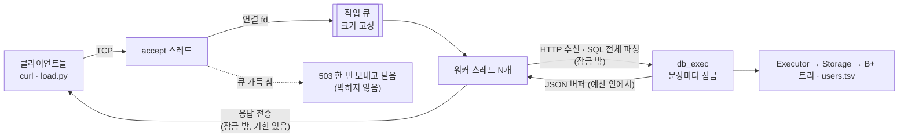

# Phase 3 개발 명세 — API 서버

> 상태: **확정(2026-11-16, 사용자).** 상한값은 초기 설정이며 P3-05 측정 뒤 조정할 수 있다. 결정의 이유는 [design.md](design.md)에 있다.

## 목표와 범위

- [과제 요구] 내부 DB 엔진(Phase 1·2)과 외부 API 서버 사이의 연결을 설계한다.
- [과제 요구] API 서버 아키텍처를 구성한다(스레드 풀).
- [과제 요구] 멀티 스레드 동시성 이슈를 찾고 해결한다.
- [확정: 사용자, 2026-11-16] 이번 학습을 위해 C로 직접 구현하고 외부 라이브러리를 쓰지 않는다. HTTP도 필요한 부분만 직접 파싱한다. 라이브러리나 프레임워크로도 과제는 할 수 있다. 다만 이번에는 스레드 풀, 요청 처리, 잠금을 직접 만들어 보는 것을 학습 목표로 삼았다(DB-P3-D01).
- [확정: 사용자, 2026-11-16] 서버는 POSIX(Linux·macOS) 전용이다. 개발과 검사는 Docker `gcc:13`에서 한다. Windows는 지금처럼 CLI만 빌드한다.
- [확정: 사용자, 2026-11-16] 진행 순서: 엔진 진입점 + 전역 mutex → 단일 스레드 HTTP 서버 → 스레드 풀 → rwlock + `pread`로 읽기 병렬화하고 성능 비교. 기존 Phase 1·2 엔진을 그대로 다시 쓴다.
- [유지] 진행 방식: 단위를 구현하고 테스트·검사로 검증한 뒤, 통과하면 커밋하고 다음 단위로 간다. 인터페이스를 바꾸는 결정은 구현 전에 제안한다. 사용자 학습은 구현·검증 순서와 분리한다(tasks.md "학습과의 분리").

## 최종 결과 — Phase 3가 끝나면 보이는 것

```text
$ build/minidb-server --data-dir data --port 8080 --threads 4
[서버] 시작: 917.5 ms (1000000행), 127.0.0.1:8080, 워커 4개, 큐 64

$ curl -s localhost:8080/query -d "SELECT * FROM users WHERE id = 3;"
{"ok":true,"results":[{"type":"select","columns":["id","name","age"],"rows":[[3,"Kim",25]]}]}

$ curl -s localhost:8080/query -d "INSERT INTO users (name, age) VALUES ('민수', 30);"
{"ok":true,"results":[{"type":"insert","id":1000001}]}

$ curl -s localhost:8080/query -d "EXPLAIN SELECT * FROM users WHERE age = 30;"
{"ok":true,"results":[{"type":"explain","plan":"FULL SCAN","condition":"age = 30","tree_height":4,"total_rows":1000001}]}

$ python3 tools/load.py --clients 16 --seconds 10      # 동시 요청 부하. 처리량과 응답 시간
```

시작 비용(파일 전체 읽기와 인덱스 구축)은 서버가 뜰 때 한 번만 든다. 그 뒤 id 조회 한 건의 **엔진 처리 시간**은 Phase 2에서 잰 수준(약 0.02 ms)일 것으로 예상한다. 실제 응답 시간에는 네트워크, HTTP·JSON 처리, 큐 대기가 더해진다. 이 값은 P3-05에서 재서 기록하며, 미리 보장하지 않는다.

## 전체 구조



## API 계약

### 요청 (확정)

| 메서드·경로 | 본문 | 의미 |
|---|---|---|
| `POST /query` | SQL 텍스트(UTF-8). 문장 하나 이상, CLI의 SQL 파일과 같은 문법 | 문장을 순서대로 실행한다 |
| `GET /health` | 없음 | 서버 상태와 행 수 |

- HTTP/1.1의 일부만 지원한다. 요청 줄, 헤더, `Content-Length` 본문까지다. 연결 하나에 요청 하나를 처리하고 닫는다(`Connection: close`). chunked 요청, keep-alive, HTTPS는 지원하지 않는다.
- 요청 본문은 최대 1 MiB, 헤더는 최대 8 KiB다.
- 기본으로 `127.0.0.1`에만 연결을 받는다. 다른 주소는 `--host`로 연다.
- **먼저 전체를 파싱한다.** 서버는 본문의 문장을 모두 파싱한 뒤 실행을 시작한다. 구문 오류가 하나라도 있으면 **아무 문장도 실행하지 않는다.** CLI는 문장마다 파싱하고 실행하므로 이 점이 다르다. 이렇게 해서 "앞 문장만 저장된" 경우를 실행 단계 오류(값 범위 등)로 좁힌다.

### 응답 형식 (확정)

`Content-Type: application/json; charset=utf-8`

```json
{"ok":true,"results":[
  {"type":"insert","id":7},
  {"type":"select","columns":["id","name","age"],"rows":[[1,"민수",25],[3,"Kim",25]]},
  {"type":"explain","plan":"INDEX RANGE SCAN","condition":"id BETWEEN 10 AND 20","tree_height":2,"total_rows":5}
]}
```

```json
{"ok":false,
 "error":{"statement":2,"code":"SQL_ERROR","message":"age는 0 이상 150 이하여야 합니다 (현재: 200)"},
 "results":[{"type":"insert","id":8}]}
```

- `results`에는 **완전히 성공한 문장의 결과만** 순서대로 들어간다. 실패한 문장과 그 뒤 문장은 들어가지 않는다(fail-fast).
- `error.code`는 프로그램이 판단할 때 쓰는 값이고, `message`는 사람용 문구다(엔진의 `DbError` 그대로, CLI와 같은 문구).
- `error.stored_id`는 실패한 INSERT의 줄이 **파일 기록 완료로 확인된** 경우에만 넣는다(아래 "저장 후 실패"). `error.reason`은 `HALTED`일 때 중단 사유다.
- `error.statement`는 특정 문장이 원인일 때만 넣는다(1부터). 요청 전체가 거절된 경우(본문의 NUL, 중단 상태)에는 넣지 않는다. [P3-02]
- `"results"`는 `/query` 응답에만 있다. `/health`와 HTTP 단계 오류(400 `BAD_REQUEST`, 404, 405, 408, 413, 431)는 `{"ok":false,"error":{"code","message"}}`만 돌려준다. [P3-02]
- accept 스레드가 보내는 503(`BUSY`, 큐에서 기다리던 연결의 `SHUTTING_DOWN`)도 요청을 읽기 전이라 `{"ok":false,"error":{"code","message"}}`만 돌려준다. 실행 도중 종료 유예가 끝나 문장 경계에서 멈춘 `SHUTTING_DOWN`은 일반 `/query` 실패 응답(`statement`, `results` 포함)이지만, 그때는 연결을 이미 끊은 뒤라 클라이언트에 닿지 않는다(결과 불명). [P3-03]
- 문자열은 JSON 규칙에 따라 이스케이프한다(`"` `\` 제어 문자는 `\u00XX`). 한글 같은 올바른 UTF-8은 그대로 둔다. 엔진은 UTF-8을 검사하지 않으므로, 저장된 값에 올바르지 않은 UTF-8 바이트가 있으면 **응답에서만** 그 바이트를 `�`(대체 문자)로 바꾼다. 파일의 값은 바뀌지 않는다. [P3-02]

| code | 상태 | 상황 | 실행 여부 |
|---|---|---|---|
| (없음, `ok:true`) | 200 | 모든 문장 성공 | 전부 실행 |
| `SQL_SYNTAX` | 400 | 구문 오류(전체 파싱 단계) | 아무것도 실행 안 함 |
| `SQL_ERROR` | 400 | 실행 단계의 값·조건 오류 | 앞 문장만 실행됨 |
| `RESULT_TOO_LARGE` | 400 | 응답 예산 초과(아래) | 앞 문장만 실행됨, 그 문장의 결과는 버림 |
| `BAD_REQUEST` | 400 | HTTP 요청 형식 오류: 요청 줄·헤더·`Content-Length` 형식, 요청 대상(경로·쿼리 문자열)에 보이는 ASCII(0x21~0x7E) 밖의 바이트(NUL·제어 문자·0x80 이상), 헤더 줄의 NUL·제어 문자(탭 제외), 서로 다른 `Content-Length`, `Transfer-Encoding`(chunked 등 미지원) [P3-02] | 아무것도 실행 안 함 |
| `NOT_FOUND` / `METHOD` | 404 / 405 | 경로 없음 / 메서드 틀림(`Allow` 헤더로 허용 메서드 안내) | 아무것도 실행 안 함 |
| `BODY_TOO_LARGE` / `HEADER_TOO_LARGE` | 413 / 431 | 요청 크기 상한 초과 | 아무것도 실행 안 함 |
| `TIMEOUT` | 408 | 요청 수신 기한 초과(보낼 수 있을 때만) | 아무것도 실행 안 함 |
| `STORAGE` | 500 | 읽기 오류, 인덱스 불일치, 파일을 건드리기 전 실패 | 앞 문장만 실행됨, 이 문장은 기록 안 됨 |
| `INDEX_FAILED` | 500 | 파일 기록 완료 뒤 인덱스 등록 실패(메모리 부족) | 앞 문장 + 이 INSERT까지 기록됨(`stored_id`) |
| `WRITE_FAILED` | 500 | 파일 쓰기 도중 오류 | 앞 문장은 기록됨, **이 INSERT는 기록 결과 불명** |
| `INTERNAL` | 500 | 응답을 만들 메모리가 없음 | **결과 불명** |
| `BUSY` | 503 | 작업 큐 가득 참 | 아무것도 실행 안 함 |
| `SHUTTING_DOWN` | 503 | 종료 중. 큐에서 대기하던 요청, 또는 종료 기한 뒤 남은 문장 | 앞 문장만 실행됨(큐 대기 요청은 아무것도 실행 안 함) |
| `HALTED` | 503 | 서버가 중단 상태(아래, `error.reason`) | 아무것도 실행 안 함 |

### 결과 크기 제한 (확정, 초기 설정)

| 상한 | 추천값 | 범위 |
|---|---|---|
| 응답 본문 바이트 `--max-response` | **8 MiB** | **요청 하나의 JSON 전체.** 모든 문장의 결과와 오류 객체를 합친 크기 |
| 결과 행 `--max-rows` | **100,000행** | **요청 하나의 모든 SELECT 행 합계** |

- **응답 크기와 실제 메모리 사용량은 다르다.** 8 MiB는 클라이언트에게 보내는 JSON 본문의 크기 상한이다. 워커 하나가 요청을 처리하는 동안 실제로 잡는 메모리는 여기에 요청 본문(최대 1 MiB), 파싱된 문장 목록, 버퍼를 키울 때의 여유분, malloc 관리 비용이 더해진다. 응답 버퍼(결과 부분 + 머리 부분)의 용량은 합쳐서 상한을 넘겨 키우지 않는다. 서버 전체로는 이 값에 동시에 처리 중인 요청 수(최대 워커 수)를 곱한 것과 인덱스 메모리를 더해야 한다. 실제 사용량은 P3-05에서 재고, 미리 보장하지 않는다.
- 두 상한 모두 요청 단위로 센다. 그래서 SELECT를 여러 개로 나눠 보내도 우회할 수 없다. 바이트 상한이 실제 메모리 보호 장치이고, 행 상한은 사용자가 이해하기 쉬운 기준이다.
- 오류 객체와 닫는 괄호를 쓸 자리(2 KiB. 오류 메시지 256바이트가 모두 `\u00XX`로 이스케이프되는 최악의 경우까지)는 예산에서 미리 떼어 둔다. 그래서 예산을 넘겨도 오류 응답은 항상 만들 수 있다. 같은 이유로 `--max-response`는 4096 이상이어야 한다. [P3-02]
- **초과 시 부분 결과:** 상한을 넘긴 SELECT의 결과는 **통째로 버린다.** 잘린 행 목록을 돌려주지 않는다. 그 앞 문장의 결과는 그대로 두고, 그 뒤 문장은 실행하지 않는다(`RESULT_TOO_LARGE`, `statement` = 넘긴 문장 번호). SELECT는 파일을 바꾸지 않으므로 이 처리로 데이터가 달라지지 않는다.
- **INSERT는 결과 자리를 먼저 확인한다.** INSERT를 실행하기 전에 그 결과(`{"type":"insert","id":...}`, 최대 40바이트)를 쓸 자리가 남았는지 확인한다. 자리가 없으면 실행하지 않고 `RESULT_TOO_LARGE`로 멈춘다. 그래서 저장에 성공한 INSERT의 결과가 예산 때문에 응답에서 빠지는 일은 없다.

### 저장 후 실패 (확정)

이 서버에는 **트랜잭션도, 자동 롤백도 없다.** 파일에 한 줄을 쓰고 나서 그 뒤 단계가 실패해도 그 줄은 파일에 남는다. 아래 정책은 그 사실을 클라이언트가 구분할 수 있게 해 주는 것까지다.

"파일 기록 완료"는 그 줄의 `fprintf`와 `fflush`가 모두 성공했다는 뜻이다. 즉 운영체제에 넘어갔다는 의미이고, 디스크에 물리적으로 기록됐다는 뜻은 아니다(`fsync` 없음, 전원 장애 대비 아님).

| 실패 지점 | 파일 | 응답 | 서버의 다음 상태 |
|---|---|---|---|
| 파일을 건드리기 전(검증, id 소진, 파일 끝 위치 확인 실패) | 변화 없음 | 400 `SQL_ERROR` 또는 500 `STORAGE` | 정상 |
| **파일 쓰기 도중 오류**(`fprintf`·`fflush` 실패) | **알 수 없음.** 줄 전체가 들어갔을 수도, 일부만 들어갔을 수도, 안 들어갔을 수도 있다 | 500 `WRITE_FAILED`, `stored_id` 없음 | 중단(사유 `write_failed`) |
| **파일 기록 완료 → 인덱스 등록 실패**(메모리 부족) | 그 줄이 온전히 남음 | 500 `INDEX_FAILED` + `stored_id` | 중단(사유 `index_failed`) |
| 파일·인덱스 성공 → 응답 JSON을 만들 메모리 부족 | 그 줄이 남음 | 500 `INTERNAL`(미리 준비한 고정 본문, id 없음) | 정상 |
| 응답 전송 실패·기한 초과, 클라이언트가 먼저 끊음 | 그 줄이 남음 | 클라이언트는 응답을 받지 못함 | 정상 |

**`stored_id`** 는 파일 기록 완료가 확인된 경우(위 표의 `INDEX_FAILED`)에만 넣는다. 쓰기 결과를 알 수 없는 `WRITE_FAILED`에는 넣지 않는다.

**중단 상태:** 서버는 이 상태에 들어가면 이후의 모든 `/query`에 503 `HALTED`(`error.reason`에 사유)로 답하고 아무것도 실행하지 않는다. `/health`도 503 `{"ok":false,"state":"halted","reason":"..."}`를 돌려준다. 다시 쓰려면 운영자가 서버를 재시작해야 한다. 사유에 따라 재시작의 결과가 다르다.

| 사유 | 파일 상태 | 재시작하면 |
|---|---|---|
| `index_failed` | 온전하다. 메모리 인덱스에만 그 id가 빠졌다 | `table_open`이 파일에서 인덱스를 다시 만들므로, 재시작 때 메모리가 충분하면 복구된다. 메모리 부족이 계속되면 시작 자체가 실패할 수 있다 |
| `write_failed` | 마지막 줄이 깨졌을 수 있다(디스크 가득 참, 입출력 오류 등) | 줄이 온전히 들어갔으면 정상으로 시작한다. 일부만 들어갔으면 `table_open`이 "데이터 파일 손상"으로 **시작을 거부한다.** 자동 복구는 없고, 운영자가 파일 끝을 직접 확인·수정해야 한다(Phase 1과 같은 규칙). 원인(디스크 공간 등)을 먼저 해결해야 한다 |

**클라이언트 재시도의 의미:**

| 받은 응답 | 이 요청의 결과 | 다시 보내도 되는가 |
|---|---|---|
| 200 | 전부 실행됨 | — |
| 400 `SQL_SYNTAX`, 404·405·413·431, 408, 503 `BUSY` | 아무것도 실행 안 됨 | 원인을 고쳐 그대로 다시 보내도 된다 |
| 503 `HALTED` | 이 요청은 아무것도 실행 안 됨 | 서버가 재시작된 뒤에만 의미가 있다. `write_failed`였다면 재시작 전에 이전 요청의 결과부터 확인해야 한다(아래 `WRITE_FAILED` 행) |
| 400 `SQL_ERROR`·`RESULT_TOO_LARGE`, 503 `SHUTTING_DOWN` | `results`에 있는 문장만 실행됨, 실패한 문장은 기록 안 됨 | **`statement` 번호부터** 다시 보낸다. 앞부분을 다시 보내면 INSERT가 한 번 더 들어간다 |
| 500 `STORAGE` | `results`에 있는 문장만 실행됨, 실패한 문장은 기록 안 됨(읽기 오류이거나 쓰기 전 실패) | 원인을 확인한 뒤 `statement` 번호부터 |
| 500 `INDEX_FAILED` + `stored_id` | `results`의 문장 + 그 INSERT까지 파일에 기록됨 | 그 INSERT는 **다시 보내지 않는다.** 재시작 뒤 `id = stored_id`로 확인하고, 그 다음 문장부터 보낸다 |
| 500 `WRITE_FAILED` | `results`의 문장은 기록됨. **실패한 INSERT는 기록 결과 불명** | 바로 다시 보내지 않는다. 재시작 뒤 조회로 그 행이 있는지 확인하고, 없을 때만 다시 보낸다. 재시작이 거부되면 파일부터 고쳐야 한다 |
| 500 `INTERNAL`, 응답 없음(끊김·시간 초과) | 요청 전체가 **결과 불명** | 바로 다시 보내지 말고 먼저 조회로 확인한다. 이 Phase에는 중복 방지 키(idempotency key)가 없다 |

### 느린 클라이언트와 기한 (확정, 초기 설정)

| 항목 | 추천값 | 의미 |
|---|---|---|
| 소켓 호출 하나의 제한 | 5초 | `recv`·`send` 한 번이 이 시간 안에 진행되지 않으면 연결을 닫는다 |
| 요청 수신 전체 기한 | 10초 | 워커가 연결을 꺼낸 순간부터 헤더와 본문을 다 받을 때까지. 넘으면 408을 한 번 시도하고 닫는다 |
| 응답 전송 전체 기한 | 10초 | 응답 첫 바이트부터 마지막 바이트까지. 넘으면 닫는다(데이터는 이미 처리됨 → "결과 불명") |
| 503 전송(accept 스레드) | 기다리지 않음 | 비차단 소켓에 고정 응답(200바이트 미만)을 `send` 한 번만 시도하고 바로 닫는다. 요청은 읽지 않는다. 다만 이미 도착해 있는 바이트(최대 64 KiB)는 비차단으로 버린다. 읽지 않은 데이터가 남은 채 닫으면 운영체제가 연결 재설정을 보내 503이 사라질 수 있어서다. 그래도 클라이언트가 503 대신 연결 재설정을 볼 수 있다(최선 노력) [P3-03] |
| 종료 유예 시간 | 10초 | 강제로 연결을 닫기 전까지 기다리는 시간. **종료 완료 시간의 절대 상한은 아니다**(아래 "종료") |

- 바이트를 조금씩 보내 기한을 늘리는 클라이언트(slowloris)는 전체 기한에서 끊긴다.
- 큐에서 기다리는 시간은 기한에 넣지 않는다. 클라이언트 쪽 제한 시간은 클라이언트가 정한다.

### 서버 실행

```text
minidb-server [--data-dir D] [--host 127.0.0.1] [--port 8080] [--threads 4] [--queue 64]
              [--max-rows 100000] [--max-response 8388608]
```

- `--threads`(워커 수, 1~256, 기본 4)와 `--queue`(처리를 기다리는 연결 수, 1~4096, 기본 64)는 P3-03에서 추가했다. 범위 밖이면 종료 코드 2. 응답은 워커마다 메모리에 만들므로 응답이 차지하는 메모리는 최대 `워커 수 × --max-response`다(기본값으로 약 32 MiB). [P3-03]
- 시작할 때 `table_open`을 한 번 실행한다. 실패하면 종료 코드 1, 잘못된 사용법이면 2로 끝난다(CLI와 같은 규칙).
- `--port 0`이면 운영체제가 빈 포트를 고른다. 실제 포트는 시작 줄에 나온다(테스트용).
- 로그는 stderr로 쓴다: 시작 줄 `[서버] 시작: 2.6 ms (0행), 127.0.0.1:8080, 워커 4개, 큐 64, 응답 상한 …`, 요청마다 `[요청] POST /query → 400 SQL_ERROR, 문장 3개, 2.10 ms`, 종료 시 `[서버] 종료`. 로그 형식은 사람용이라 계약에 넣지 않는다(바뀔 수 있다). [P3-02]
- **종료(SIGINT·SIGTERM):**
  1. 새 연결을 받지 않는다.
  2. 큐에서 아직 시작하지 않은 요청에는 503 `SHUTTING_DOWN`을 보내고 닫는다(위의 비차단 방식).
  3. 처리 중인 요청은 끝까지 처리한다.
  4. 10초가 지나면 남은 연결을 강제로 닫는다. 워커는 **다음 문장 경계에서** 멈추고 `SHUTTING_DOWN`으로 끝낸다.
  5. 엔진 안에서 이미 실행 중인 문장은 중간에 끊지 않는다. 파일 쓰기를 반쯤 남기지 않기 위해서다. 그래서 10초는 **유예 시간이지 종료 완료의 절대 상한이 아니다.** 실제 종료는 10초에 "실행 중인 문장들이 끝날 때까지"가 더해진다. 그 시간은 데이터 크기와 디스크 상태에 달려 있어서 서버가 보장하지 않는다. 참고로 100만 건 선형 탐색은 Windows에서 약 0.8초였고, 디스크가 멈추면 더 길어질 수 있다.
  6. 마지막으로 파일을 닫고 종료 코드 0으로 끝낸다. SIGKILL이나 전원 차단은 이 절차 밖이다.
- **외부 변경:** 서버가 떠 있는 동안 다른 프로세스(CLI 포함)가 같은 `users.tsv`를 바꾸는 것은 **지원하지 않는다.** 엔진은 인덱스로 읽은 줄의 id가 기대와 다르면 오류(500 `STORAGE`)를 내지만, 이것은 일부 경우만 잡아내는 안전장치일 뿐 감지를 보장하지 않는다. 예를 들어 같은 위치에 같은 id로 이름만 바꾼 줄, 파일 끝에 덧붙인 줄은 감지하지 못한다.

## 동시성 계약 (정상 빌드 기준)

| ID | 보장 | 확인 방법 |
|---|---|---|
| C1 | 동시에 들어온 INSERT도 id가 중복 없이 1씩 증가한다 | 정확성 테스트 |
| C2 | 문장 하나는 원자적으로 보인다. SELECT는 실행 도중 끼어든 INSERT의 줄(반쯤 쓰인 줄 포함)을 보지 않는다. 시작 시점에 있던 행은 모두 본다 | 정확성 테스트 |
| C3 | 성공 응답을 받은 INSERT는 그 뒤에 시작한 모든 SELECT에 보인다 | 정확성 테스트 |
| C4 | 동시 실행 뒤에도 B+ 트리 불변식과 "트리 ↔ 파일" 일치가 유지된다. 재시작하면 같은 내용이 복원된다 | 정확성 테스트 |
| C5 | 정상 빌드의 테스트 실행에서 ThreadSanitizer가 데이터 경쟁을 보고하지 않는다(테스트가 지나간 경로에 한함) | `make tsan` |
| C6 | 엔진 잠금을 잡은 채로 네트워크 입출력을 하지 않는다. 느린 클라이언트는 자기 워커 하나를 위 기한까지만 붙잡는다 | 코드 구조 + 느린 클라이언트 테스트 |
| C7 | 엔진 잠금은 하나이고, 잠금 안에서 다른 잠금을 잡지 않는다. 이 규칙으로 교착을 피하도록 설계한다. 규칙을 지키는지는 코드 리뷰와 TSan(잠금 순서 검사 포함)으로 확인하며, 그 이상의 증명은 하지 않는다 | 리뷰 + `make tsan` |

## 제외

트랜잭션(여러 문장 원자성)과 롤백, 중복 방지 키, 디스크 동기화(`fsync`), keep-alive·HTTPS·인증, 노드 단위 잠금(설명만), 레코드 수정·삭제, Windows 서버 빌드, 실행 중인 외부 파일 변경 지원.

## 완료 시나리오

| ID | 확인 | 단위 |
|---|---|---|
| S1 | `db_*` 진입점과 전역 잠금 아래에서 동시 정확성 테스트(C1~C4)와 `make tsan`(C5)이 통과한다. CLI 출력은 바이트 단위로 같다 | P3-01 |
| S1x | (실험, 통과·실패 판정 없음) 잠금을 끈 빌드에서 경쟁이 나타나는 모습(id 중복, 인덱스 불일치, TSan 보고)을 관찰해 기록한다 | P3-01 |
| S2 | HTTP 요청·응답, JSON 형식, 오류 코드·상태 코드, 요청·응답 크기 상한, 저장 후 실패 정책, 실행 예시와 요청 경로 지도 | P3-02 |
| S3 | 스레드 풀·큐: 동시 요청, 503 `BUSY`가 막히지 않음, 기한, 종료 절차 | P3-03 |
| S4 | 읽기 병렬화: 조회 경로가 공유 상태를 쓰지 않음, rwlock, 전역 잠금과 처리량 비교 | P3-04 |
| S5 | 부하 측정, Phase 1·2 회귀(A1~A8, B1~B8), ASan·TSan 통과, 문서 정리 | P3-05 |
