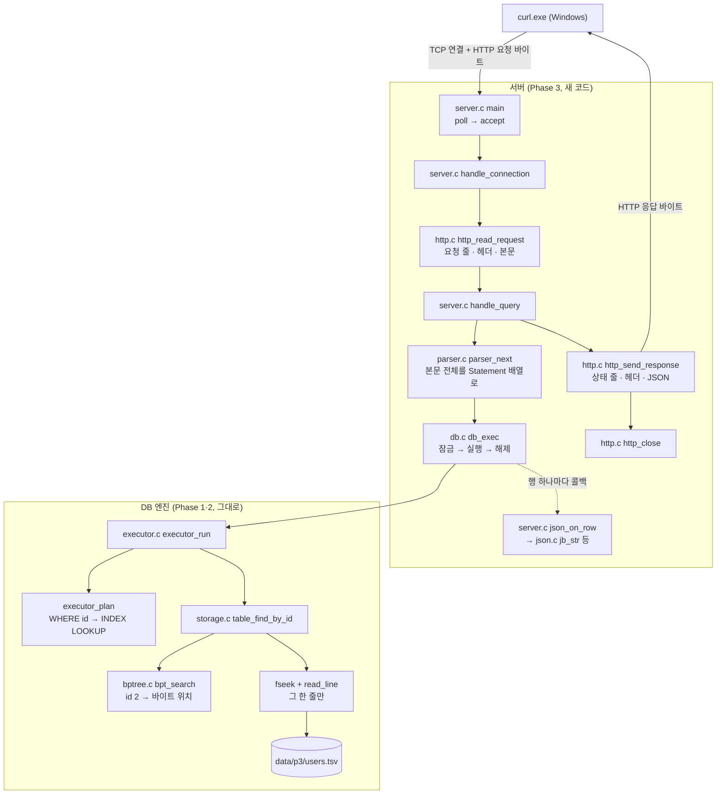
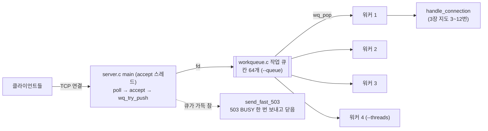

# Phase 3 실습 — 요청 하나가 DB 엔진까지 가는 길

P3-02(단일 스레드 HTTP 서버)에서 시작했고, **P3-03(스레드 풀)에서 바뀐 부분은 [6장](#6-p3-03-스레드-풀--느린-손님이-있어도-다른-요청은-바로), P3-04(읽기 병렬화)는 [7장](#7-p3-04-읽기-병렬화--select끼리는-같이-insert는-혼자), P3-05(부하 측정)는 [8장](#8-p3-05-부하-측정--지금까지-바꾼-것을-숫자로)에 따로 모았다.** 먼저 서버를 띄우고 요청을 보내 응답을 본다. 그 다음 그 요청이 어느 파일의 어느 함수를 거쳐 `users.tsv`까지 갔다 오는지 지도로 따라간다.

## 1. 서버 띄우기 (Windows에서 Docker로)

서버는 POSIX 전용이라(DB-P3-D02) Docker 안에서 띄우고, 요청은 Windows에서 보낸다. 프로젝트 폴더에서 PowerShell을 연다.

```powershell
docker run --rm -it -p 127.0.0.1:8080:8080 -v "${PWD}:/src" -w /src gcc:13 `
  bash -c "make build/minidb-server && mkdir -p data/p3 && build/minidb-server --host 0.0.0.0 --port 8080 --data-dir data/p3"
```

```text
[서버] 시작: 2.6 ms (0행), 0.0.0.0:8080, 워커 4개, 큐 64, 응답 상한 8388608바이트·100000행
```

(`워커 4개, 큐 64`는 P3-03부터 나온다. 6장에서 다룬다.)

- `--host 0.0.0.0`: 컨테이너 바깥(Windows)에서 들어오는 연결을 받으려면 컨테이너 안에서는 모든 주소로 열어야 한다. 대신 `-p 127.0.0.1:8080:8080`으로 **Windows 쪽은 이 컴퓨터에서만** 접속하게 묶었다.
- 이 창은 서버 로그 창이다. 요청이 올 때마다 `[요청] ...` 줄이 찍힌다. 끌 때는 `Ctrl+C`(SIGINT)를 누른다. 그러면 `[서버] 종료`가 찍히고 파일을 닫는다.
- 데이터는 `data/p3/users.tsv`에 쌓인다. Phase 1·2와 같은 파일 형식이다.

## 2. 요청 보내기

**새 PowerShell 창**을 열고, **먼저 프로젝트 폴더로 이동한다.** 새 창은 보통 홈 폴더(`C:\Users\USER`)에서 열린다. 그런데 `@examples/...`는 지금 폴더를 기준으로 파일을 찾으므로, 이동하지 않으면 `curl: option --data-binary: error encountered when reading a file`이 난다.

```powershell
cd C:\Users\USER\Desktop\KraftonJungle\miniDBMS
```

PowerShell의 `curl`은 다른 명령의 별칭이라 반드시 `curl.exe`라고 쓴다. 한글이 든 SQL은 파일로 보내는 것(`@파일`)이 안전하다. `-d` 대신 `--data-binary`를 쓰는 이유는 `-d`가 파일의 줄바꿈을 지우기 때문이다.

### ① 살아 있나

```powershell
curl.exe -s http://localhost:8080/health
```

```json
{"ok":true,"state":"ok","rows":0}
```

### ② INSERT 4개를 한 요청으로

```powershell
curl.exe -s http://localhost:8080/query --data-binary "@examples/phase3_seed.sql"
```

```json
{"ok":true,"results":[{"type":"insert","id":1},{"type":"insert","id":2},{"type":"insert","id":3},{"type":"insert","id":4}]}
```

결과는 문장 순서대로 `results`에 하나씩 들어간다. CLI가 `INSERT 1`을 네 번 찍던 것과 같은 정보다. 대신 부여된 id까지 알려 준다.

### ③ id 조회 (B+ 트리 경로)

```powershell
curl.exe -s http://localhost:8080/query --data-binary "SELECT * FROM users WHERE id = 2;"
```

```json
{"ok":true,"results":[{"type":"select","columns":["id","name","age"],"rows":[[2,"Kim",30]]}]}
```

### ④ 선형 탐색과 그 실행 계획을 한 번에

```powershell
curl.exe -s http://localhost:8080/query --data-binary "SELECT * FROM users WHERE age = 25; EXPLAIN SELECT * FROM users WHERE age = 25;"
```

```json
{"ok":true,"results":[
  {"type":"select","columns":["id","name","age"],"rows":[[1,"민수",25],[3,"지영",25]]},
  {"type":"explain","plan":"FULL SCAN","condition":"age = 25","tree_height":1,"total_rows":4}]}
```

(실제 응답은 한 줄이다. 읽기 쉽게 줄을 나눴다.)

### ⑤ 중간에 실패하는 요청 — 상태 코드와 부분 실행

`-i`를 붙이면 응답 헤더도 보인다.

```powershell
curl.exe -s -i http://localhost:8080/query --data-binary "@examples/phase3_partial.sql"
```

```text
HTTP/1.1 400 Bad Request
Content-Type: application/json; charset=utf-8
Content-Length: 167
Connection: close

{"ok":false,"error":{"statement":2,"code":"SQL_ERROR","message":"age 값 200이(가) 허용 범위(0~150)를 벗어났습니다"},"results":[{"type":"insert","id":5}]}
```

- 1번 문장('성공')은 **이미 저장됐다**(`results`에 id 5). 2번 문장에서 멈췄고, 3번은 실행되지 않았다.
- 트랜잭션이 없으므로 1번이 되돌려지지 않는다. 이 요청을 그대로 다시 보내면 '성공'이 한 번 더 들어간다. 다시 보낼 때는 `statement` 번호(2)부터 보낸다(spec "클라이언트 재시도의 의미").

### ⑥ 구문 오류는 아무것도 실행하지 않는다

```powershell
curl.exe -s -i http://localhost:8080/query --data-binary "INSERT INTO users (name, age) VALUES ('x', 1); SELEC * FROM users;"
```

`400`과 `"code":"SQL_SYNTAX"`, `"statement":2`, `"results":[]`가 온다. 서버는 **실행하기 전에 본문 전체를 먼저 파싱**하므로 1번 INSERT도 들어가지 않는다. ①을 다시 보내 `rows`가 그대로인지 확인해 보자. CLI는 문장마다 파싱하고 실행하므로 이 점이 다르다.

서버 로그 창에는 이렇게 찍혀 있을 것이다.

```text
[요청] GET /health → 200, 0.85 ms
[요청] POST /query → 200, 문장 4개, 4.89 ms
[요청] POST /query → 200, 문장 1개, 2.57 ms
[요청] POST /query → 200, 문장 2개, 1.59 ms
[요청] POST /query → 400 SQL_ERROR, 문장 3개, 2.10 ms
[요청] POST /query → 400 SQL_SYNTAX, 문장 0개, 0.26 ms
```

## 3. 전체 지도 — ③번 요청 하나가 지나가는 길

`curl.exe ... --data-binary "SELECT * FROM users WHERE id = 2;"` 하나를 따라간다. 왼쪽이 새로 생긴 서버 쪽(Phase 3), 오른쪽 아래가 Phase 1·2에서 만든 엔진이다.



| 순서 | 파일 · 함수 | 하는 일 | 이 요청에서 |
|---|---|---|---|
| 1 | `server.c` `main` | 시작할 때 `db_open`으로 파일 전체를 읽어 B+ 트리를 만든다(한 번만). 그 뒤 `poll`로 연결을 기다리다 `accept` | 시작 줄의 `2.6 ms`가 이 비용이다 |
| 2 | `server.c` `handle_connection` | 연결 하나를 처리하고, 끝나면 로그 한 줄을 찍는다 | |
| 3 | `http.c` `http_read_request` | 빈 줄(`\r\n\r\n`)까지 헤더를 읽고, `Content-Length`만큼 본문을 읽는다. 호출마다 5초, 전체 10초 기한 | 본문 = `SELECT * FROM users WHERE id = 2;` |
| 4 | `server.c` 경로 확인 | `POST /query` → `handle_query`, `GET /health` → `handle_health`, 나머지 404·405 | |
| 5 | `parser.c` `parser_next` (반복) | 본문의 문장을 **모두** `Statement`로 바꾼다. 하나라도 실패하면 400 `SQL_SYNTAX`로 끝, 실행 없음 | `{SELECT, WHERE_ID, 2}` 하나 |
| 6 | `db.c` `db_exec` | 엔진 잠금을 잡고 `executor_run`을 부른 뒤 놓는다. 중단 상태면 실행하지 않는다 | (잠금은 P3-03부터 의미가 생긴다) |
| 7 | `executor.c` `executor_run` → `executor_plan` | 조건 종류로 경로를 고른다. EXPLAIN이 보여 주는 바로 그 결정 | `INDEX LOOKUP` |
| 8 | `storage.c` `table_find_by_id` → `bptree.c` `bpt_search` | 트리에서 id 2의 바이트 위치를 찾는다 | 위치 = 1번째 줄 길이 + 1 |
| 9 | `storage.c` `read_line` | 그 위치로 `fseek` 해서 **한 줄만** 읽고, 읽은 줄의 id가 정말 2인지 다시 확인한다 | `2\tKim\t30` |
| 10 | `server.c` `json_on_row` → `json.c` | `ResultSink`의 행 콜백. CLI는 같은 자리에서 TSV를 `printf` 했고, 서버는 JSON 버퍼에 `[2,"Kim",30]`을 쓴다. 요청 전체의 행 수·바이트 예산을 여기서 센다 | |
| 11 | `server.c` `handle_query` 끝 | 머리(`{"ok":true,"results":[`) + 결과 + `]}`를 정한다. 실패했다면 머리에 `error` 객체가 들어간다 | |
| 12 | `http.c` `http_send_response` → `http_close` | 상태 줄·헤더·본문을 보내고(전체 10초 기한), 쓰기 쪽을 닫는다 | `HTTP/1.1 200 OK` |

**CLI와 비교하면** 바뀐 것은 1~5와 10~12뿐이다. 6번 아래, 즉 `executor_run`부터 `users.tsv`까지는 Phase 2 코드를 한 줄도 바꾸지 않고 그대로 쓴다. 엔진은 결과가 화면(TSV)으로 가는지 네트워크(JSON)로 가는지 모른다. `ResultSink` 콜백만 바꿔 끼웠다.

```text
CLI:   SQL 파일 → main.c ──────────── parser_next → db_exec → (엔진) → print_row     → stdout
서버:  HTTP 요청 → http.c → server.c → parser_next → db_exec → (엔진) → json_on_row → HTTP 응답
```

## 4. 직접 해 볼 것

각 항목은 먼저 결과를 예상해 보고 실행한다.

1. **CLI로 같은 파일 읽기.** 서버를 `Ctrl+C`로 끈 뒤, 같은 데이터를 CLI로 읽어 본다. 서버가 쓴 행이 그대로 보이는가?
   ```powershell
   mingw32-make
   "SELECT * FROM users;" | Out-File -Encoding ascii build\q.sql
   .\build\minidb.exe --data-dir data/p3 build\q.sql
   ```
   Docker에서 `make clean`을 했다면 Windows용 `build\minidb.exe`도 지워진다. 그럴 때는 `mingw32-make`로 다시 만든다.
2. **재시작.** 서버를 다시 띄우면 시작 줄의 행 수는 몇인가? 다음 INSERT는 몇 번 id를 받는가?
3. **응답 예산.** 서버를 `--max-rows 2`로 다시 띄우고 `SELECT * FROM users WHERE id = 1; SELECT * FROM users;`를 보낸다. `statement`는 몇이고, `results`에는 무엇이 남는가? 행 상한은 문장마다 세는가, 요청 전체로 세는가?
4. **HTTP 오류.** `curl.exe -s -i http://localhost:8080/query`(본문 없는 GET)와 `curl.exe -s -i http://localhost:8080/nope`의 상태 코드와 `Allow` 헤더를 보자.
5. **한 번에 하나씩 (P3-02 서버 기준).** P3-02 서버는 연결을 하나씩 처리했다. P3-03부터는 결과가 달라진다(6장 실습 1). 한 창에서 본문을 덜 보내는 요청을 보낸다. 본문이 100바이트라고 해 놓고 6바이트만 보내므로 서버가 나머지를 기다린다.
   ```powershell
   curl.exe -s -i http://localhost:8080/query -H "Content-Length: 100" --data-binary "SELECT"
   ```
   곧바로 다른 창에서 ①을 보낸다. ①의 응답은 언제 오는가? 첫 번째 창에는 무엇이 오는가? (확인한 결과: ①은 약 5초 뒤에 왔고, 첫 창은 5초 뒤 `408`과 `TIMEOUT`을 받았다. 소켓 호출 하나의 기한이 5초다.) 이 현상이 P3-03(스레드 풀)을 하는 이유다.

## 5. 다음 단위에서 이 지도가 바뀌는 곳

- **P3-03 스레드 풀 (완료, 6장):** 1~2번이 "accept 스레드 → 작업 큐 → 워커 N개"로 나뉜다. 3번부터는 워커 하나 안에서 지금과 같다. 6번 `db_exec`의 잠금이 그때부터 실제로 다른 워커를 기다리게 한다.
- **P3-04 읽기 병렬화 (완료, 7장):** 6번의 잠금이 읽기·쓰기 잠금으로 바뀐다. 9번의 `fseek` + `read_line`이 `pread`로 바뀐다. 이유는 [tasks.md](tasks.md) "S1x 관찰 기록"에 있다. 잠금 없이 동시에 읽으면 파일 위치가 섞였다.

## 6. P3-03 스레드 풀 — 느린 손님이 있어도 다른 요청은 바로

### 바뀐 지도

3장 지도의 1~2번만 바뀌었다. 3번(`http_read_request`)부터는 워커 하나 안에서 예전과 똑같다.



| 순서 | 파일 · 함수 | 하는 일 |
|---|---|---|
| 1 | `server.c` `main` | 시작할 때 워커 스레드 4개를 만든다. 그 뒤로는 **연결을 받아 큐에 넣기만** 한다. 요청을 읽지 않으니 느린 손님에게 묶이지 않는다 |
| 1-a | `workqueue.c` `wq_try_push` | 큐에 빈칸이 있으면 넣고 잠든 워커 하나를 깨운다. 가득 차면 **기다리지 않고** 실패한다 |
| 1-b | `server.c` `send_fast_503` | 큐가 가득 차면 503 `BUSY`를 한 번 보내고 바로 닫는다. 요청은 읽지 않는다 |
| 2 | `server.c` `worker_main` → `wq_pop` | 워커는 큐가 비어 있으면 잠들어 있다가, fd가 들어오면 꺼내서 `handle_connection`(예전과 같은 처리)을 한다 |

**동시에 일어나는 것과 아닌 것:** 워커 4개가 각자 요청을 받고, 파싱하고, 응답을 보내는 일은 동시에 한다. 하지만 엔진(`db_exec`)은 아직 전역 잠금 하나라서 **문장 실행은 한 번에 하나**다. 그래서 이번 단위로 빨라지는 건 "느린 네트워크 때문에 기다리던 시간"이다. 무거운 SELECT 여러 개를 동시에 보내도 아직은 차례로 실행된다. 이 부분은 P3-04에서 바뀐다.

**메모리:** 응답은 워커마다 메모리에 만든다(2장). 그래서 응답이 차지하는 메모리는 최대 `워커 수 × 응답 상한(8 MiB)`, 기본값으로 약 32 MiB까지 늘 수 있다.

### 실습

서버를 새 코드로 다시 띄운다. 1장의 명령을 그대로 쓰면 `make`가 다시 빌드한다. 아래 명령은 모두 **프로젝트 폴더의 새 PowerShell 창**에서 실행한다. 백그라운드 작업(`Start-Job`)의 한글이 깨지지 않도록 작업 안에서 UTF-8을 지정했다.

**실습 1 (필수) — 느린 손님이 있어도 바로 답하는가**

알 수 있는 것: 4장 실습 5에서 3초 넘게 기다리던 요청이 이제 바로 처리된다. 이것이 스레드 풀을 만든 이유다.

```powershell
$slow = Start-Job { [Console]::OutputEncoding = [Text.Encoding]::UTF8; curl.exe -s -i http://localhost:8080/query -H "Content-Length: 100" --data-binary "SELECT" }
Start-Sleep -Seconds 2
(Measure-Command { curl.exe -s http://localhost:8080/health }).TotalMilliseconds
Receive-Job $slow -Wait
```

- P3-02 서버: `/health`가 약 3,400 ms 걸렸다(느린 요청이 끝날 때까지 줄을 섰다).
- P3-03 서버: 수백 ms 안쪽이다(대부분 `curl.exe`를 띄우는 시간). 느린 요청은 다른 워커가 붙잡고 있고, `/health`는 남은 워커가 바로 처리한다.
- 느린 요청은 예전처럼 5초 뒤 `408 TIMEOUT`을 받는다. 기한은 그대로 필요하다. 워커 4개를 모두 붙잡으면 다시 막히기 때문이다.

**실습 2 (필수) — 큐가 가득 차면 기다리지 않고 거절하는가**

알 수 있는 것: 서버가 감당할 수 있는 양을 넘으면 손님을 무한히 줄 세우지 않고 **바로** 503을 돌려준다. 클라이언트는 기다리다 시간 초과되는 대신 "지금 바쁘다"를 즉시 안다.

서버를 끄고(`Ctrl+C`) **워커 1개, 큐 1칸으로** 다시 띄운다. 기본 설정(워커 4개, 큐 64칸)으로 띄운 서버에서는 남는 워커가 있어서 503이 나오지 않는다. 시작 줄에 `워커 1개, 큐 1`이 보이는지 먼저 확인한다.

```powershell
docker run --rm -it -p 127.0.0.1:8080:8080 -v "${PWD}:/src" -w /src gcc:13 `
  bash -c "make build/minidb-server && mkdir -p data/p3 && build/minidb-server --host 0.0.0.0 --port 8080 --data-dir data/p3 --threads 1 --queue 1"
```

다른 창에서 아래를 통째로 붙여 넣는다. 첫 줄은 이 창의 출력 인코딩을 UTF-8로 바꾼다. `curl.exe` 출력을 `| Out-Host`처럼 파이프로 넘기면 PowerShell이 Windows 기본 인코딩(CP949)으로 해석해 503 메시지의 한글이 깨지기 때문이다.

자리는 딱 두 개다(워커 1개 + 큐 1칸). `$a`(5초 동안 안 끝나는 느린 요청)가 워커를, `$b`가 큐 1칸을 먼저 채운 뒤 세 번째 요청을 보낸다.

```powershell
[Console]::OutputEncoding = [Text.Encoding]::UTF8
$a = Start-Job { [Console]::OutputEncoding = [Text.Encoding]::UTF8; curl.exe -s -i http://localhost:8080/query -H "Content-Length: 100" --data-binary "SELECT" }
Start-Sleep -Seconds 2
$b = Start-Job { [Console]::OutputEncoding = [Text.Encoding]::UTF8; curl.exe -s http://localhost:8080/health }
Start-Sleep -Seconds 2
(Measure-Command { curl.exe -s -i http://localhost:8080/health | Out-Host }).TotalMilliseconds
Receive-Job $a, $b -Wait
```

| 누구 | 상태 | 받는 것 |
|---|---|---|
| `$a` 느린 요청 | 하나뿐인 워커를 붙잡음 | 5초 뒤 `408 TIMEOUT` |
| `$b` `/health` | 큐의 한 칸에서 기다림 | `$a`가 끝나면 `{"ok":true,...}` |
| 마지막 `/health` | 워커도 큐도 꽉 참 | **바로** `503 Service Unavailable`, `{"ok":false,"error":{"code":"BUSY","message":"서버가 바쁩니다"}}` |

마지막 줄의 시간이 수백 ms 안쪽이면 "기다리지 않고 거절"이 확인된 것이다. 서버 로그 창에는 `[요청] 503 BUSY (큐 1개가 가득 참)`이 찍힌다. 503 `BUSY`는 아무것도 실행하지 않았으므로 그대로 다시 보내도 된다(spec "재시도" 표).

**실습 3 (선택) — 끌 때 기다리던 손님은 어떻게 되는가**

알 수 있는 것: 서버를 끄는 순간 큐에서 기다리던 요청은 "종료 중"이라는 답을 받는다. 처리 중이던 요청은 끝까지 처리된다. 아무 말 없이 끊기지 않는다.

실습 2의 서버(`--threads 1 --queue 1`)에서, 위 명령의 앞 세 줄(`$a`, 2초 대기, `$b`)만 보낸다. 곧바로 서버 창에서 `Ctrl+C`를 누른 뒤 `Receive-Job $a, $b -Wait`를 실행한다.

- `$b`(큐에서 기다리던 요청): 바로 `503`, `"code":"SHUTTING_DOWN"`
- `$a`(처리 중이던 요청): 끝까지 처리된다. 여기서는 본문이 안 와서 5초 기한에 `408`
- 서버 로그: `[서버] 종료 중: 대기하던 연결 1개에 503, ...` → `[서버] 종료`

처리 중인 요청이 10초(유예 시간) 안에 끝나지 않으면 서버가 그 연결을 끊고, 다음 문장 경계에서 멈춘다. 이 경우는 수동으로 재현하기 어려워 자동 테스트(`shutdown_grace_stops_at_statement_boundary`)로 확인했다.

### 다음 단위 (P3-04)

P3-03까지는 워커가 4개여도 엔진 잠금이 하나라서 문장 실행은 한 줄로 섰다. P3-04에서 읽기(SELECT)끼리는 동시에 실행되게 바꿨다(7장).

## 7. P3-04 읽기 병렬화 — SELECT끼리는 같이, INSERT는 혼자

### 바뀐 지도

3장 지도의 6번(잠금)과 9번(파일 읽기)만 바뀌었다.

| 순서 | 파일 · 함수 | P3-03까지 | P3-04 |
|---|---|---|---|
| 6 | `db.c` `db_exec` | 잠금 하나(mutex). SELECT도 INSERT도 한 번에 하나 | **읽기·쓰기 잠금**(rwlock). SELECT·EXPLAIN은 공유 잠금이라 여러 개가 같이 들어간다. INSERT는 배타 잠금이라 혼자 들어가고, 그동안 SELECT는 기다린다 |
| 9 | `storage.c` `read_line` | 모두가 같이 쓰는 `FILE*` 하나에 `fseek`로 위치를 옮긴 뒤 읽었다 | `read_at`(`pread`)으로 **읽을 위치를 매번 지정**한다. 위치와 읽기 버퍼는 요청마다 따로다. 그리고 조회를 시작할 때의 `file_size`까지만 읽는다 |

**왜 9번을 바꿔야 6번을 바꿀 수 있나:** SELECT 둘이 같이 들어가면, 둘이 같은 `FILE*`의 위치를 서로 옮긴다. A가 `fseek(줄 2)`를 한 직후 B가 `fseek(줄 7)`을 하면, A는 줄 7을 읽는다. P3-01의 잠금 없는 실험(`make race-demo`)에서 실제로 16,000번 중 수십~수백 번 "인덱스와 데이터 파일이 일치하지 않습니다"가 났다. 읽을 위치를 매번 지정하면 이런 일이 없다. 지금 같은 실험을 돌리면 읽기는 16,000번 모두 정상이다(tasks.md "P3-04 뒤 다시 관찰").

**INSERT는 왜 여전히 혼자인가:** 같은 실험에서 INSERT끼리는 여전히 같은 id를 받는다(`last_id + 1`을 동시에 읽음). B+ 트리 분할 도중에 다른 스레드가 트리를 읽으면 위험한 것도 그대로다. 그래서 INSERT가 도는 동안은 SELECT도 기다린다.

**쓰기 우선:** 처음에는 Linux 기본 읽기·쓰기 잠금(읽기 우선)을 썼다. 그러자 선형 탐색이 겹쳐서 계속 들어오는 동안 INSERT가 **20초 넘게** 들어가지 못했다. 공유 잠금이 한 순간도 비지 않았기 때문이다(writer 기아). 그래서 "INSERT가 기다리기 시작하면 새로 온 SELECT는 그 뒤에 선다"(쓰기 우선)로 바꿨다. 그 결과 INSERT는 뒤에 온 탐색에 계속 밀리지 않는다. 다만 응답 시간의 상한을 보장하는 것은 아니다(먼저 기다리던 다른 INSERT, 스케줄링 등이 더해질 수 있다).

```text
읽기 우선:  [탐색A────][탐색C────][탐색E────] ...   INSERT: 영영 못 들어감
            [탐색B────][탐색D────][탐색F────] ...
쓰기 우선:  [탐색A────]           [탐색C────]
            [탐색B────][INSERT]   [탐색D────]       INSERT 뒤에 온 C·D는 INSERT를 기다림
```

### 실습

**실습 1 (필수) — 동시에 읽으면 정말 빨라지는가, INSERT는 얼마나 기다리는가**

알 수 있는 것: 같은 데이터·같은 요청으로 "전역 잠금"과 "읽기·쓰기 잠금"을 나란히 잰다. 잠금 방식 하나만 바꿨을 때 처리 시간이 얼마나 달라지는지 숫자로 본다.

프로젝트 폴더의 PowerShell에서 실행한다(서버를 띄워 둘 필요 없음. 100만 행을 만들고 두 서버를 차례로 띄워 재므로 1분 정도 걸린다).

```powershell
docker run --rm -v "${PWD}:/src" -w /src gcc:13 make read-bench
```

이 컴퓨터(Docker, CPU 8개)에서 나온 값:

| 항목 | 전역 잠금 (P3-03까지) | 읽기·쓰기 잠금 (P3-04) |
|---|---|---|
| 선형 탐색 1개 응답 | 78 ms | 77 ms |
| 선형 탐색 4개 동시, 전체 시간 | 304 ms | 88 ms |
| INSERT 응답 (선형 탐색 4개가 계속 도는 중), 중앙값 / 최대 | 180 ms / 2,869 ms | 77 ms / 114 ms |

읽는 법:
- **탐색 1개**는 두 방식이 비슷하다. 혼자일 때는 잠금 방식이 상관없다.
- **탐색 4개 동시**: 전역 잠금은 한 줄로 서서 1개의 약 4배(304 ms, 3.9배)가 걸린다. 읽기·쓰기 잠금은 같이 읽어서 거의 1개 시간(88 ms, 1.1배)이다.
- (P3-04 때 처음 잰 값은 813 → 313 ms였다. 그때는 측정 도구가 데이터를 Windows와 공유하는 폴더에 둬서 파일 읽기가 느렸다. 지금은 컨테이너 안 임시 폴더를 쓴다. [benchmark.md](benchmark.md) 5)
- **INSERT**: 쓰기 우선이라 뒤에 온 탐색에 밀리지 않는다. 이 실험의 최대 114 ms는 관찰값이고 상한 보장이 아니다(탐색 1개 77 ms보다도 길었다).
- 숫자는 컴퓨터마다 다르다. 볼 것은 "두 열의 차이"다.

**실습 2 (선택) — 클라이언트를 CPU보다 많이 보내면**

알 수 있는 것: 읽기를 동시에 돌려도 CPU 수 이상으로는 빨라지지 않는다. "동시에 실행"과 "빨라짐"은 같은 말이 아니다.

```powershell
docker run --rm -v "${PWD}:/src" -w /src gcc:13 make read-bench READ_CLIENTS=16
```

클라이언트와 워커를 16개로 늘린다. Docker의 CPU 수(위에서는 8개)를 넘기면 "1개 대비" 배수가 다시 커지는지 본다. 이 컴퓨터에서는 16개 동시가 전역 잠금 1,189 ms(9.6배), 읽기·쓰기 잠금 274 ms(3.7배)였다. 여전히 4배 넘게 빠르지만, 4개일 때(1.1배)보다 배수가 커졌다. CPU 8개를 16개 요청(과 클라이언트)이 나눠 썼기 때문이다.

## 8. P3-05 부하 측정 — 지금까지 바꾼 것을 숫자로

### 무엇을 재나

지금까지는 요청을 손으로 하나씩 보냈다. 이번에는 부하 생성기(`tools/loadgen.c`)가 클라이언트 수십 개처럼 쉬지 않고 요청을 보내고, 초당 몇 건을 처리하는지(처리량)와 응답 시간 분포(p50·p95·p99)를 잰다. 결과와 해석은 [benchmark.md](benchmark.md)에 있다.

| 묶음 | 바꾸는 것 | 확인하는 설계 결정 |
|---|---|---|
| 1 | CLI 한 번 실행 vs 떠 있는 서버 | 서버 구조: 시작 비용을 한 번만 낸다 (Phase 2의 "2배 미만"과 비교) |
| 2 | 워커 1·2·4·8개 | 스레드 풀 (P3-03) |
| 3 | 요청 종류 × 전역 잠금 / 읽기·쓰기 잠금 | 읽기 병렬화 (P3-04) |
| 4 | 큐 1칸 / 64칸 | 큐 크기와 503 (P3-03) |
| 5 | 로그·데이터 위치 | 잠금 밖의 병목 |

**p50·p99:** 응답 시간을 짧은 순서로 줄 세웠을 때 가운데(50%)와 99% 위치의 값이다. p50은 "보통 사용자", p99는 "운이 나쁜 100명 중 1명"이 기다린 시간이다. 평균은 아주 느린 몇 건에 끌려가서 잘 쓰지 않는다.

### 실습

**실습 1 (필수) — 직접 돌려 보고 benchmark.md와 비교**

알 수 있는 것: 각 설계 결정이 만든 차이를 내 컴퓨터에서 숫자로 본다. 특히 묶음 1(Phase 2와 비교)과 묶음 3의 선형 탐색 줄이 이 Phase의 핵심이다.

```powershell
docker run --rm -v "${PWD}:/src" -w /src gcc:13 make load-bench
```

약 2분 걸리고, 같은 표가 `build/load_result.md`에도 저장된다. 이 컴퓨터에서 나온 값 중 핵심만 옮기면 이렇다(전체는 benchmark.md).

| 질문 | 값 |
|---|---|
| id 하나 조회: CLI 한 번 실행 vs 서버 | 346 ms vs **0.18 ms** |
| id 조회 처리량: 워커 1개 vs 8개 | 7,434 vs **30,109**건/초 |
| 선형 탐색(클라이언트 4개): 전역 잠금 vs 읽기·쓰기 잠금 | 14 vs **45**건/초, p99 2,000 vs **109** ms |
| 몰릴 때(클라이언트 16개, 워커 1개) 503 수: 큐 1칸 vs 64칸 | 2초 동안 32,893번 vs **0번** |

숫자는 컴퓨터마다 다르고, 같은 컴퓨터에서도 회차마다 흔들린다(표의 "3회 범위"). 볼 것은 같은 표 안의 위아래 차이다.

**표 읽는 법:** "성공"은 본문까지 끝까지 받은 200 응답만이다. "불완전·실패·기타"가 0이 아니면 측정을 믿기 전에 원인부터 본다. "늦음(제외)"는 측정 구간이 끝날 때 진행 중이던 요청 수라 보통 클라이언트 수와 같고, 처리량에는 들어가지 않는다.

**실습 2 (선택) — 측정이 틀어졌던 이유 읽기**

알 수 있는 것: 잠금을 잘 나눠도, 요청마다 지나가는 다른 공유 자원이 느리면 그것이 상한이 된다.

benchmark.md 5를 읽는다. 처음 측정에서는 서버 로그를 Windows 공유 폴더에 써서 처리량이 약 1,000건/초에서 멈췄다(지금은 2만 건 이상). 또 요청마다 새 연결을 맺어 닫힌 연결(TIME_WAIT)이 쌓이자 같은 설정이 절반 속도로 나왔다. 둘 다 잠금과 상관없는 병목이다.
