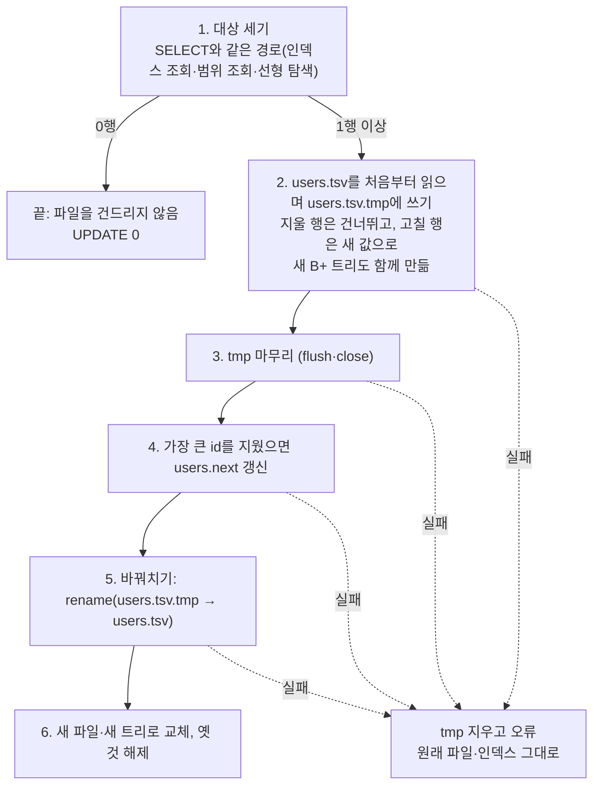
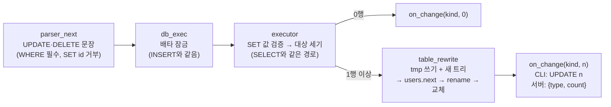

# Phase 4 실습 — UPDATE·DELETE

UPDATE·DELETE를 CLI와 서버에서 직접 실행해 본다. 각 실습에는 **왜 하는지**와 **알 수 있는 것**을 적었다. 필수만 해도 Phase 4의 핵심(파일 통째로 다시 쓰기, 다음 id 보존, 실패 시 무변경)을 볼 수 있다.

아래 출력은 2026-11-18에 Windows(TDM-GCC 빌드 CLI)와 Docker `gcc:13`(서버)에서 실제로 받은 값이다. 측정 시간(ms)은 실행할 때마다 다르다.

## 0. 준비

```powershell
mingw32-make                                  # build\minidb.exe
Remove-Item -Recurse -Force data\p4 -ErrorAction SilentlyContinue
build\minidb.exe --data-dir data\p4 examples\phase4_seed.sql
Get-Content data\p4\users.tsv
```

```text
1	kim	25
2	lee	30
3	park	30
4	choi	41
5	jung	19
```

## 1. (필수) CLI로 고치고 지우기

**왜:** 새 문장 두 개가 무엇을 돌려주는지, 조회 결과가 어떤 순서로 나오는지 본다.

```powershell
Get-Content examples\phase4_change.sql
build\minidb.exe --data-dir data\p4 examples\phase4_change.sql
```

```text
UPDATE 2
UPDATE 1
DELETE 1
UPDATE 0
id	name	age
1	O'Brien	25
2	lee	31
4	choi	41
5	jung	19
```

- 첫 줄 `UPDATE 2`: `WHERE age = 30`에 맞은 행이 2개(lee, park)라는 뜻이다. 결과 숫자는 **조건에 맞은 행 수**다. 값이 원래와 같아도 센다.
- 넷째 줄 `UPDATE 0`: id 3은 바로 앞에서 지웠으므로 맞는 행이 없다. 오류가 아니다.
- SELECT 결과는 id 순서 그대로이고 3번만 빠졌다.

**알 수 있는 것:** UPDATE·DELETE 결과는 "바뀐 행 수" 한 줄이다. 지운 자리는 비고, 남은 행의 id는 바뀌지 않는다.

## 2. (필수) 파일은 어떻게 바뀌었나

**왜:** Phase 4의 저장 방식(파일 통째로 다시 쓰기)을 눈으로 확인한다.

```powershell
Get-Content data\p4\users.tsv
Get-ChildItem data\p4 -Name
```

```text
1	O'Brien	25
2	lee	31
4	choi	41
5	jung	19
users.tsv
```

INSERT는 파일 끝에 한 줄을 붙였다. UPDATE·DELETE는 줄 길이가 바뀌거나 줄이 사라지므로 그 자리에서 고칠 수 없다. 그래서 **바뀐 내용 전체를 `users.tsv.tmp`에 새로 쓰고 원래 파일과 바꿔치기**한다. 실행이 끝나면 임시 파일은 남지 않는다.



5번 바꿔치기는 한 번에 일어난다. 그래서 그 앞에서 실패하면 원래 파일이 그대로이고, 일부 행만 바뀐 파일은 생기지 않는다(문장 하나가 원자적). 이 과정은 배타 잠금 안에서 일어나므로, 다시 쓰는 동안 다른 조회·INSERT는 기다린다.

**알 수 있는 것:** UPDATE·DELETE 한 번의 비용은 바뀐 행 수가 아니라 **파일 전체 크기**에 비례한다. 100만 행 파일에서 한 행을 고쳐도 파일 전체를 다시 쓴다(이번 Phase에서는 재지 않았다).

## 3. (필수) 가장 큰 id를 지우면 다음 id는?

**왜:** 다시 쓰기 방식에서 생기는 함정을 본다. 다음 id는 원래 "파일에 있는 가장 큰 id + 1"이었다. 가장 큰 id의 행을 지우면 파일만 봐서는 그 id가 있었는지 알 수 없다.

```powershell
Get-Content examples\phase4_next_id.sql
build\minidb.exe --data-dir data\p4 examples\phase4_next_id.sql
Get-Content data\p4\users.next
```

```text
DELETE 1
INSERT 1
id	name	age
4	choi	41
6	han	22
5
```

- id 5를 지웠는데 새 행은 5가 아니라 **6**을 받았다.
- `users.next`에 `5`가 남았다. 다음 실행은 `max(파일의 가장 큰 id, users.next)`에서 다음 id를 정한다. 그래서 다시 실행해도 5를 다시 주지 않는다.
- `users.next`는 가장 큰 id를 지울 때만 쓴다. INSERT마다 쓰지 않으므로 INSERT 비용은 Phase 3와 같다.

**알 수 있는 것:** 지운 id를 다시 쓰면 "id 5를 지웠다"는 기록이 엉뚱한 새 행을 가리키게 된다. 그래서 id는 한 번 쓰면 다시 쓰지 않는다.

## 4. (필수) 중간에 틀리면 어디까지 반영되나

**왜:** CLI의 fail-fast 규칙이 UPDATE에도 같은지 본다.

```powershell
Get-Content examples\phase4_errors.sql
build\minidb.exe --data-dir data\p4 examples\phase4_errors.sql; "종료 코드 $LASTEXITCODE"
Get-Content data\p4\users.tsv
```

```text
UPDATE 1
오류: 문장 2: age 값 200이(가) 허용 범위(0~150)를 벗어났습니다
종료 코드 1
1	O'Brien	25
2	lee	50
4	choi	41
6	han	22
```

- 문장 1(lee → 50)은 반영됐다. 문장 2는 값 검사에서 실패해 **아무 행도 바꾸지 않았고**, 문장 3은 실행되지 않았다(choi는 41 그대로).
- 값 검사는 INSERT와 같은 규칙이다(name 1~255바이트·탭/줄바꿈 불가, age 0~150).

**알 수 있는 것:** 문장 하나는 전부 반영되거나 하나도 반영되지 않는다. 여러 문장을 묶는 트랜잭션은 없다.

## 5. (선택) 맞는 행이 없으면 파일을 건드리지 않는다

**왜:** "0행이면 다시 쓰지 않는다"는 규칙을 파일 수정 시각으로 확인한다.

```powershell
(Get-Item data\p4\users.tsv).LastWriteTime.ToString("HH:mm:ss.fff")
Set-Content -Encoding ascii data\p4_zero.sql "UPDATE users SET age = 1 WHERE id = 999; DELETE FROM users WHERE age = 77;"
build\minidb.exe --data-dir data\p4 data\p4_zero.sql
(Get-Item data\p4\users.tsv).LastWriteTime.ToString("HH:mm:ss.fff")
```

출력은 `UPDATE 0`, `DELETE 0`이고, 앞뒤 수정 시각이 같아야 한다. 1행 이상 바꾸는 문장으로 같은 일을 하면 시각이 바뀐다.

**알 수 있는 것:** 대상을 먼저 세는 단계(다시 쓰기 순서 1번)가 있어서, `WHERE id = 999` 같은 문장은 B+ 트리만 보고 끝난다.

## 6. (선택) `--timing`으로 비용 차이 보기

**왜:** 다시 쓰기가 일어난 문장과 아닌 문장의 시간 차이를 본다.

```powershell
build\minidb.exe --data-dir data\p4 --timing examples\phase4_change.sql
```

```text
[측정] 문장 1: 0.0321 ms, 수정 0행
[측정] 문장 2: 13.2411 ms, 수정 1행
[측정] 문장 3: 0.0023 ms, 삭제 0행
[측정] 문장 4: 0.0012 ms, 수정 0행
[측정] 문장 5: 0.0338 ms, 결과 4행
```

(stdout 결과 줄은 생략) 이미 한 번 실행한 파일이라 대부분 0행이다. 문장 2(id 1의 이름 고치기)만 실제로 다시 썼고 시간이 크게 다르다. 4행짜리 파일이라 시간 대부분은 파일 만들기·바꿔치기 같은 고정 비용으로 보인다(추정, 따로 나눠 재지 않았다).

**알 수 있는 것:** 0행 문장은 조회 한 번의 비용, 1행 이상 문장은 파일 전체를 다시 쓰는 비용이다.

## 7. (필수) 서버로 UPDATE·DELETE

**왜:** 같은 기능이 HTTP API에서 어떤 JSON으로 오는지 본다.

서버 띄우기(창 1, Phase 3와 같은 방식):

```powershell
docker run --rm -it -p 127.0.0.1:8080:8080 -v "${PWD}:/src" -w /src gcc:13 bash -c "make build/minidb-server && mkdir -p data/p4s && build/minidb-server --host 0.0.0.0 --port 8080 --data-dir data/p4s"
```

요청(창 2):

```powershell
curl.exe -s http://localhost:8080/query --data-binary "@examples/phase4_seed.sql"
curl.exe -s http://localhost:8080/query --data-binary "UPDATE users SET age = 31 WHERE age = 30; DELETE FROM users WHERE id = 5; SELECT * FROM users;"
curl.exe -s http://localhost:8080/query --data-binary "INSERT INTO users (name, age) VALUES ('han', 22); UPDATE users SET age = 200 WHERE id = 1;"
curl.exe -s http://localhost:8080/query --data-binary "DELETE FROM users;"
```

```text
{"ok":true,"results":[{"type":"insert","id":1},{"type":"insert","id":2},{"type":"insert","id":3},{"type":"insert","id":4},{"type":"insert","id":5}]}
{"ok":true,"results":[{"type":"update","count":2},{"type":"delete","count":1},{"type":"select","columns":["id","name","age"],"rows":[[1,"kim",25],[2,"lee",31],[3,"park",31],[4,"choi",41]]}]}
{"ok":false,"error":{"statement":2,"code":"SQL_ERROR","message":"age 값 200이(가) 허용 범위(0~150)를 벗어났습니다"},"results":[{"type":"insert","id":6}]}
{"ok":false,"error":{"statement":1,"code":"SQL_SYNTAX","message":"DELETE에는 WHERE 조건이 필요합니다 (모든 행을 바꾸는 DELETE는 지원하지 않음)"},"results":[]}
```

- 둘째 요청: `{"type":"update","count":2}`가 CLI의 `UPDATE 2`와 같다.
- 셋째 요청: INSERT는 실행됐고(id 6, 가장 큰 id 5를 지웠으므로 6), UPDATE는 값 오류라 아무것도 바꾸지 않았다. `statement: 2`부터 고쳐 다시 보내면 된다.
- 넷째 요청: WHERE 없는 DELETE는 구문 오류다. 구문 오류는 요청 전체를 실행하지 않는다(Phase 3 규칙 그대로).

**알 수 있는 것:** UPDATE·DELETE는 같은 문장을 두 번 보내도 결과가 같다(SET 값이 상수이고, 지운 행은 다시 지울 게 없다). INSERT와 달리 "결과를 못 받았을 때 다시 보내도 되나"를 고민하지 않아도 된다.

> **Docker Desktop(Windows) 공유 폴더에서 본 현상:** 서버가 `/src` 아래(공유 폴더)를 데이터 디렉터리로 쓰는 동안 UPDATE·DELETE를 한 뒤에는, **같은 컨테이너 안의 다른 프로세스**가 `users.tsv`를 열면 "No such file or directory"가 났다(`docker exec ... cat`). 서버를 끄면 보였다. Windows 쪽 `Get-Content`로는 서버가 떠 있는 동안에도 보였다. 컨테이너 자체 디렉터리(`/tmp`)에서는 생기지 않았다. "열린 채로 이름이 바뀐 파일"을 공유 폴더가 다루는 방식 때문이다(짧은 재현 스크립트로 확인). 엔진의 정확성과는 별개이고, 서버가 쓰는 동안 같은 디렉터리를 CLI로 동시에 여는 것은 원래 지원하지 않는다(Phase 3와 같음). 같은 이유로 Docker에서 `make test`를 돌릴 때는 저장소를 컨테이너 안에 복사해서 돌렸다(tasks.md 검증 기록).

## 8. 요청이 엔진까지 가는 지도 — Phase 4에서 바뀐 부분



| 파일 | 바뀐 것 |
|---|---|
| `src/parser.c` | `UPDATE ... SET ... WHERE ...;`, `DELETE FROM ... WHERE ...;` |
| `src/executor.c` | SET 값 검증, 대상 세기(SELECT와 같은 경로), `table_rewrite` 호출, `on_change` 결과 |
| `src/storage.c` | `table_rewrite`(다시 쓰기 순서 1~6), `users.next` 읽기·쓰기, 시작 시 남은 임시 파일 정리 |
| `src/db.c` | UPDATE·DELETE도 배타 잠금. 실패해도 원래 상태가 남으므로 중단 상태로 바꾸지 않음(Windows 다시 열기 실패만 예외) |
| `src/main.c`, `src/server.c` | `UPDATE n`·`DELETE n`, `{"type":"update","count":n}`. 서버는 결과 자리를 실행 전에 확보 |

조회 경로(`table_scan`·`table_find_by_id`·`table_find_id_range`)는 바꾸지 않았다. 파일이 계속 id 순서이고, 바꿔치기는 배타 잠금 안에서만 일어나기 때문이다.

## 9. 읽을거리: 다시 쓰기 vs 덧붙이기 (채택하지 않은 방식)

| | 다시 쓰기 (채택) | 덧붙이기 (채택 안 함) |
|---|---|---|
| UPDATE·DELETE 하는 일 | 파일 전체를 새로 쓰고 바꿔치기 | 파일 끝에 "id 3 삭제", "id 2의 새 값" 같은 줄을 붙임 |
| 한 번의 비용 | 파일 크기에 비례 (느림) | 한 줄 (빠름) |
| 파일 모양 | 항상 "살아 있는 행만, id 순서" | 같은 id가 여러 번 나옴. 조회할 때 마지막 것만 골라야 함 |
| 조회 경로 | 그대로 | 선형 탐색·범위 조회가 지운 행·옛 값을 걸러야 함. 인덱스는 마지막 위치를 가리켜야 함 |
| 파일 크기 | 지우면 줄어듦 | 계속 커짐. 언젠가 정리(압축)가 필요 |
| 실패 처리 | 바꿔치기 한 번이라 단순 | 반쯤 쓰인 줄 처리가 INSERT와 같은 문제 |

이번 Phase는 "로직을 정확히" 구현하는 것이 목표라 단순한 다시 쓰기를 골랐다(DB-P4-D01). 실제 DBMS는 페이지 단위로 제자리에서 고치고, 로그(WAL)로 원자성을 지킨다. 덧붙이기 방식은 LSM 트리(LevelDB·RocksDB)의 출발점과 비슷하다.

## 10. (선택) 테스트로 확인하기

실패 주입(임시 파일 쓰기·users.next 쓰기·바꿔치기 실패)은 실제로 일으키기 어려워서 테스트 빌드에서만 한다.

```powershell
mingw32-make test
```

| 확인 | 테스트 |
|---|---|
| 어느 단계에서 실패해도 원래 파일·조회 결과 그대로, 임시 파일 없음, 엔진은 정상 상태 | `test_p4_rewrite_failure_keeps_original` |
| Windows: 바꿔치기 뒤 다시 열기 실패 → 중단 상태, 재시작하면 복원 | `test_p4_windows_reopen_failure_halts` (Windows에서만) |
| 무작위 UPDATE·DELETE 60번을 배열 모델과 비교(파일 전체, 인덱스 조회, 트리 불변식, 재시작) | `test_p4_model_random` |
| 4개 스레드가 INSERT·UPDATE·DELETE·SELECT를 섞어도 각 스레드의 기록과 일치, 재시작 뒤에도 같음 | `test_p4_concurrent_mixed` |
