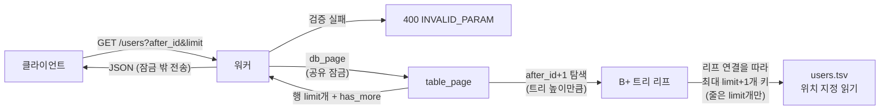

# Phase 5 설계와 결정 — 커서 페이지 조회

## 결정 목록

| ID | 항목 | 상태 |
|---|---|---|
| DB-P5-D01 | 범위: `GET /users` 커서 페이지 조회 + 엔진 제한 읽기. SQL `LIMIT`·`OFFSET` 제외, `/query`·CLI 무변경 | 확정(2026-11-18, 사용자) |
| DB-P5-D02 | `has_more`: `limit + 1`번째 행이 있는지로 판단, 그 행은 응답에 넣지 않음(구현: 인덱스 키로 확인하고 줄은 읽지 않음) | 확정(2026-11-18, 사용자) |
| DB-P5-D03 | `next_cursor`: 응답에 넣은 마지막 행의 id. 빈 페이지면 `null` | 확정(2026-11-18, 사용자) |
| DB-P5-D04 | 동시 변경: 전체 스냅샷 보장 안 함. 보장은 커서 0에서 시작해 돌려받은 커서를 따라가는 **순방향 조회**로 한정("계속 있던 행은 정확히 한 번"). 같은 페이지 재요청의 exactly-once 전달은 보장 안 함 | 확정(2026-11-18, 사용자, 범위 한정) |
| DB-P5-D05 | 파라미터: `after_id`(기본 0), `limit`(기본 `min(100, 페이지 상한)`, 최대 페이지 상한) | 확정(2026-11-18, 사용자) |
| DB-P5-D06 | 입력 검증: 엄격하게 거부, 새 오류 코드 `INVALID_PARAM`(400), 앞자리 0 거부 | 확정(2026-11-18, 사용자) |
| DB-P5-D07 | 엔진: `table_page`·`db_page`, N+1 판단은 엔진, Parser·Executor를 거치지 않음 | 확정(2026-11-18, 사용자) |
| DB-P5-D08 | 응답 상한: JSON 최악 크기와 고정 부분으로 페이지 상한을 계산, 넘는 `limit`은 거절. 실패 방지는 결과 크기 상한에 한정 | 확정(2026-11-18, 사용자, 수정) |
| DB-P5-D09 | 응답 형식: `columns` + 배열 `rows` + `has_more` + `next_cursor` | 확정(2026-11-18, 사용자) |
| DB-P5-D10 | 측정: 변경 없는 100만 행에서 전체 조회 실패, 페이지 전체 순회 정확성, 페이지 응답 시간과 바이트 | 확정(2026-11-18, 사용자, 수정) |
| DB-P5-D11 | 진행: P5-01~P5-03을 이어서 만들고 한 번에 검증. 단위마다 그 단위의 테스트는 실행해 통과시킨다 | 확정(2026-11-18, 사용자) |

## 결정의 이유 (P5-00에서 검토한 내용)

표의 "추천"을 사용자가 확정했다. D04·D08·D10은 사용자가 범위를 고쳤고, 고친 내용은 표 아래에 있다.

| 항목 | 추천 | 이유 | 다른 선택 |
|---|---|---|---|
| D03 빈 페이지의 `next_cursor` | `null` | "마지막 행의 id"라는 규칙을 그대로 따르면 행이 없을 때 값이 없다. 클라이언트는 `has_more: false`만 보고 멈추면 된다 | 요청의 `after_id`를 그대로 돌려준다. 새 행이 들어왔는지 같은 값으로 다시 물어보기(폴링)는 편하지만, "마지막 행의 id"라는 규칙에 예외가 생긴다 |
| D04 보장 문구 | "순회 시작부터 끝까지 계속 있던 행은 정확히 한 번 나온다"를 **보장으로 명시**하고 테스트한다 | id 증가·재사용 없음(P4-D04)·id 수정 불가(P4-D07) 덕분에 실제로 성립하고, 커서 방식을 고른 이유를 클라이언트 계약으로 보여 준다. 동시 테스트에서 "시작과 끝 모두에 있던 행" 집합으로 확인할 수 있다(지운 id는 다시 생기지 않으므로 "시작과 끝에 다 있음"이 곧 "계속 있음"이다) | 스냅샷 없음만 적고 그 이상은 약속하지 않는다(문서는 짧지만, 클라이언트가 중복 제거를 직접 해야 하는지 알 수 없다) |
| D05 파라미터 | `after_id`(기본 0), `limit`(기본 100, 최대 1000. 실제 최대는 D08의 페이지 상한) | 이름이 뜻을 그대로 말한다: "이 id 뒤". 기본값이 있으면 `GET /users`만으로 첫 페이지를 받는다. 1000행은 최악의 이름으로도 약 1.5 MB라 기본 응답 상한(8 MiB) 안에 넉넉히 든다 | `limit` 필수, 최대 100(GitHub API의 `per_page`와 같은 수준). `cursor`라는 이름(불투명 커서처럼 보이지만 실제로는 id라 오해 소지) |
| D06 검증·오류 코드 | 엄격하게 거부한다(spec "입력 검증" 표). 오류 코드는 새로 **`INVALID_PARAM`(400)**. 앞자리 0은 거부(`0` 하나만 허용) | 모르는 파라미터·중복을 조용히 넘기면 클라이언트가 원하지 않은 페이지를 받고도 모른다. `BAD_REQUEST`는 지금 "HTTP 형식 오류"라는 뜻이라, 형식은 맞고 값이 틀린 경우와 구분하는 편이 클라이언트에게 낫다. 앞자리 0 거부는 데이터 파일의 id를 읽는 규칙(`storage.c`의 `parse_digits`, 정규형 10진수만)과 같다. 같은 id를 여러 표기로 쓸 수 없게 된다 | `BAD_REQUEST` 재사용(코드 수는 그대로). 모르는 파라미터 무시(많은 웹 API의 관례, 확장에 너그러움). 앞자리 0 허용(`010` → 10, 너그럽지만 표기가 여러 개가 됨) |
| D07 엔진 인터페이스 | 아래 "엔진" 절. `table_page` + `db_page`를 새로 두고, **N+1 판단은 엔진이 한다**(`has_more`를 돌려줌). Parser·Statement·Executor는 거치지 않는다 | SQL `LIMIT`을 하지 않기로 했으므로 Statement에 숨은 limit 필드를 두면 반쪽짜리 SQL 기능이 생긴다. N+1을 엔진이 하면 단위 테스트로 `has_more`를 직접 확인하고, 서버가 N+1을 잘못 셀 여지가 없다 | (가) 결과 콜백이 "정상 멈춤"을 돌려줄 수 있게 `RowFn` 계약을 넓힌다(지금은 0이 아니면 오류). 다른 조회에도 쓸 수 있지만 기존 콜백 모두의 의미를 다시 확인해야 한다. (나) Executor에 `executor_page`를 두어 계층을 맞춘다(지금 흐름과 같지만, 검증할 값이 없어 얇은 전달 함수가 된다) |
| D08 응답 상한 | 서버 시작 때 **페이지 상한**을 `min(1000, --max-rows, (--max-response − 고정 부분) ÷ 한 행 최대 JSON)`으로 계산한다. `limit`이 넘으면 400. `/users`에서는 `RESULT_TOO_LARGE`가 나오지 않는다 | 최악의 경우를 미리 계산해 두면 "데이터가 많아서 실패"를 원천적으로 막는다. 이번 주제가 바로 그 실패를 없애는 것이다. 규칙이 결정적이라 테스트하기 쉽다 | (가) 페이지를 바이트 예산에 맞춰 줄여 보낸다(`has_more: true`). 실패가 없지만 "limit보다 적게 와도 끝이 아니다"라는 규칙이 생기고, 콜백의 정상 멈춤(D07-가)이 필요하다. (나) 지금처럼 넘치면 `RESULT_TOO_LARGE`. 가장 단순하지만 기본값이 아닌 설정에서는 페이지 조회도 실패할 수 있다 |
| D09 응답 형식 | `{"ok":true,"columns":[...],"rows":[[...]],"has_more":..,"next_cursor":..}`. 행은 `/query`처럼 배열 | `/query`의 select 결과와 같은 모양이라 클라이언트 코드를 재사용할 수 있다. 크기가 작아 페이지 상한 계산도 그대로다 | 행을 객체로(`[{"id":1,"name":"..","age":25}]`). 읽기 쉽고 REST 관례에 가깝지만 행마다 키 이름이 붙어 커지고, `/query`와 형식이 달라진다 |
| D10 측정 | 100만 행에서 작은 측정 세 가지만 한다: (1) 첫·중간·마지막 페이지의 응답 시간과 응답 바이트, (2) 1000행씩 전체 순회에 걸린 시간과 요청 수, (3) 같은 데이터의 `SELECT *`가 `RESULT_TOO_LARGE`로 끝나는 시간·바이트. 엔진이 읽은 행 수는 테스트로 확인(측정 아님) | 이번 주제의 출발점(클라이언트가 목록을 못 받음)과 완료(받을 수 있음)를 숫자로 보여 줄 최소한이다. 부하 측정은 하지 않는다 | 측정하지 않는다(Phase 4처럼 로직에 집중). 발표 자료는 테스트 결과와 설명으로만 |
| D11 진행 | P5-01~P5-03을 이어서 구현·자체 검증·커밋하고 한 번에 검증받는다 | Phase 4 후반과 같은 방식. 엔진 변경이 작고 서버 테스트가 엔진 동작까지 같이 확인한다 | 단위마다 검증(P5-01 PASS 뒤 P5-02) |

**사용자가 고친 부분 (2026-11-18):**
- D04: 보장을 "커서 0에서 시작해 돌려받은 커서를 따라가는 순방향 조회"로 한정한다. 같은 페이지를 다시 요청했을 때의 exactly-once 전달과 전체 스냅샷은 보장하지 않는다(spec "동시 변경과 보장").
- D08: 거절 방식은 그대로다. 페이지 상한 계산에 JSON 최악 크기(한 행 1,559바이트)와 응답 고정 부분(102바이트)을 넣고, 기본 `limit`도 `min(100, 페이지 상한)`으로 맞춘다. "실패하지 않는다"는 말은 결과 크기 상한에 걸리는 실패에만 쓴다. 그 밖의 실패(메모리 부족, 읽기 오류, 503 등)는 그대로 있을 수 있다.
- D10: 측정은 변경 없는 100만 행에서 세 가지다. (1) `SELECT *` 전체 조회의 실패, (2) 페이지 전체 순회의 정확성(파일과 비교), (3) 페이지 응답 시간과 바이트. 전체 순회 시간은 확인 항목이 아니다(순회하면서 함께 나오면 참고로만 적는다).
- D11: 한 번에 검증받기 전에도 단위마다 그 단위의 테스트를 실행한다.

## 요청 흐름

```text
클라이언트 GET /users?after_id=200&limit=100
  → accept 스레드 → 작업 큐 → 워커
  → http_read_request (쿼리 문자열을 따로 보관)
  → 파라미터 검증 (실패 → 400 INVALID_PARAM, 엔진 안 부름)
  → db_page(after_id, limit)            [공유 잠금]
       → table_page: B+ 트리로 after_id+1 이상의 첫 리프 → 리프 연결을 따라 최대 limit+1개의 키
       → 앞의 limit행만 파일에서 읽어 콜백으로 JSON에, limit+1번째 키는 has_more만 표시(줄은 안 읽음)
  → {"ok":true,...,"has_more":..,"next_cursor":..}
  → 응답 전송 (잠금 밖)
```



## 엔진 (D07)

```c
/* storage.h — id > after_id인 행을 id 순서로 최대 limit개 fn에 넘긴다.
 * limit+1번째 키가 인덱스에 있으면 *has_more = 1 (그 줄은 읽지 않는다). 거기서 멈추며, 이 멈춤은 오류가 아니다.
 * after_id가 INT64_MAX면 행 없이 *has_more = 0. 0 성공, -1 실패(err).
 * fn이 0이 아닌 값을 돌려주면 지금 범위 조회와 같이 DBE_SINK 오류다. */
int table_page(Table *t, int64_t after_id, int64_t limit, RowFn fn, void *ctx, int *has_more, DbError *err);

/* db.h — 공유 잠금 안에서 table_page. 중단 상태면 DBE_HALTED. 콜백은 잠금 안에서 불린다(db_exec와 같은 규칙). */
int db_page(Db *db, int64_t after_id, int64_t limit, RowFn fn, void *ctx, int *has_more, DbError *err);
```

- `table_page`는 `table_find_id_range`와 같은 위치 지정 읽기(`range_visit`, P3-04)를 쓴다. 다른 점은 읽은 줄 수를 세다가 `limit + 1`번째 키를 받으면 그 줄은 읽지 않고 `has_more`만 표시한 뒤 **정상 멈춤 값**을 돌려준다는 것이다. `bpt_range`는 콜백이 0이 아닌 값을 돌려주면 그 값을 그대로 돌려주므로(`bptree.c`), `table_page`가 그 값을 "성공"으로 해석한다. B+ 트리 코드는 바꾸지 않는다.
- 범위는 `[after_id + 1, INT64_MAX]`다. `after_id = INT64_MAX`면 트리를 보지 않고 빈 결과로 끝난다(넘침 방지).
- 테스트 빌드(`MINIDB_TESTING`)에는 이 스레드의 마지막 호출에서 파일에서 읽은 줄 수를 돌려주는 함수(`table_test_page_lines_read`, 스레드마다 따로)를 둔다. E1의 "읽은 줄 수 = `min(limit, 남은 행)`"을 확인하는 데 쓴다.
- 잠금은 SELECT와 같은 공유 잠금이다. UPDATE·DELETE의 다시 쓰기는 배타 잠금이므로 페이지 하나를 읽는 동안 파일과 인덱스가 바뀌지 않는다.

## 서버

| 파일 | 바뀌는 것 |
|---|---|
| `http.{h,c}` | `HttpRequest`에 쿼리 문자열(`?` 뒤, 최대 256바이트) 보관. 지금은 버린다. 길이를 넘으면 400 |
| `server.c` | `/users` 경로(GET만, 그 밖 405), 파라미터 검증(`INVALID_PARAM`), `db_page` 호출과 JSON 작성, 페이지 상한 계산과 시작 줄 표시, 404 안내 문구에 `GET /users` 추가, 요청 로그 |
| `storage.{h,c}`, `db.{h,c}` | 위 "엔진" |

- 응답은 `/query`처럼 워커가 메모리 버퍼에 만들고, 잠금을 놓은 뒤 보낸다(Phase 3 C6).
- 페이지 상한 덕분에 응답 버퍼는 `--max-response`를 넘지 않는다. 그래도 버퍼 쓰기가 실패하면(메모리 부족) 500 `INTERNAL`이다.
- 파라미터 검증은 `server.c` 안의 작은 함수로 둔다. 서버 테스트에서 spec의 입력 검증 표를 모두 확인한다.

## 동시성

- 페이지 하나는 공유 잠금 안에서 읽으므로 한 시점의 상태다(Phase 3 C2).
- 페이지 사이에는 스냅샷이 없다(D04). 보장 범위는 spec "동시 변경과 보장" 표다.
- 동시 테스트 방법(E5):
  1. 시작 상태를 기록한다.
  2. 한 클라이언트가 작은 `limit`으로 커서 0부터 돌려받은 커서를 따라 끝까지 순방향으로 읽는 동안, 다른 클라이언트들이 INSERT·UPDATE·DELETE를 섞어 보낸다.
  3. 끝난 뒤 상태를 기록한다.
  4. 확인한다: (가) 순회로 받은 id 전체가 엄격하게 증가한다(겹침 없음). (나) 시작과 끝 모두에 있던 id는 모두 순회에 있다(누락 없음). (다) 순회에 나온 id는 모두 어느 시점엔가 존재했던 id다.
  5. 단위 테스트(`db_page`를 스레드로)와 서버 테스트(HTTP) 두 곳에서 한다. 단위 쪽은 TSan으로도 돌린다.

## 테스트

| 종류 | 내용 |
|---|---|
| 단위(Storage·DB) | spec E1의 모든 경우. 읽은 행 수, `has_more`, 다시 쓰기 뒤 같은 결과, 조기 종료가 오류가 아님. 동시 순회(E5) |
| 서버 | spec E2~E5. 입력 검증 표의 모든 행, 405, `HALTED`, 큰 데이터 끝까지 순회(`--max-rows`를 작게 해서 `SELECT *`가 실패하는 데이터를 빠르게 만든다), 페이지 상한(`--max-response 4096` 등), 최악의 이름, 동시 순회 |
| 회귀 | Phase 1~4 전체(E7). `/query` 응답은 바이트 단위로 같아야 한다 |
