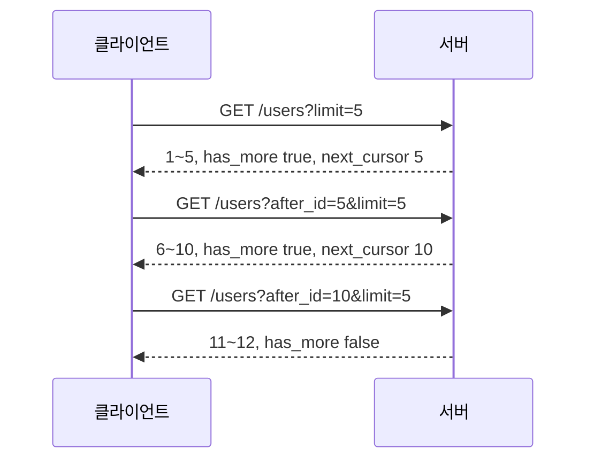

# Phase 5 실습 — 커서 페이지 조회

데이터가 많아서 받지 못하던 목록을 `GET /users`로 끝까지 받아 본다. 실습마다 **왜 하는지**와 **알 수 있는 것**을 적었다. 필수(1~4)만 해도 Phase 5의 핵심을 볼 수 있다. 핵심은 세 가지다: 전체 조회의 실패, 커서를 따라가는 순회, N+1로 정하는 `has_more`.

아래 출력은 2026-11-18에 Docker `gcc:13`의 서버에서 실제로 받은 값이다. 실습은 앞에서부터 같은 데이터로 이어진다.

## 0. 준비 — 결과 상한을 작게 해서 서버 띄우기

100만 행을 만들지 않아도 같은 현상을 보도록 `--max-rows 5`로 띄운다. "한 응답에 5행까지"인 서버다.

```bash
# 터미널 1 (PowerShell, 저장소 폴더)
docker run --rm -it -p 127.0.0.1:8080:8080 -v "${PWD}:/src" -w /src gcc:13 bash -c "make build/minidb-server && rm -rf data/p5 && mkdir -p data/p5 && build/minidb-server --host 0.0.0.0 --port 8080 --data-dir data/p5 --max-rows 5"
```

```text
[서버] 시작: 0.5 ms (0행), 127.0.0.1:8080, 워커 4개, 큐 64, 응답 상한 8388608바이트·5행, 페이지 상한 5행(기본 5)
```

- 시작 줄 끝의 `페이지 상한 5행(기본 5)`가 이번 Phase에서 생긴 부분이다. `GET /users`의 `limit` 최대값과 생략했을 때의 값이다. `--max-rows`가 5라서 페이지 상한도 5다.
- 터미널 2에서 12행을 넣는다(이름 u1~u12, 나이 21~32).

```powershell
# 터미널 2
$sql = (1..12 | ForEach-Object { "INSERT INTO users (name, age) VALUES ('u$_', $(20 + $_));" }) -join " "
curl.exe -s http://localhost:8080/query --data-binary $sql > $null
```

아래에서 `curl.exe -s "http://localhost:8080/..."`는 줄여서 경로만 적는다.

## 1. (필수) 전체 조회는 실패하고, 페이지로는 끝까지 받는다

**왜:** 이번 Phase의 출발점인 "데이터가 많으면 목록을 아예 못 받는다"를 먼저 보고, 같은 서버에서 페이지로 받아 본다.

```powershell
curl.exe -s http://localhost:8080/query --data-binary "SELECT * FROM users;"
```

```json
{"ok":false,"error":{"statement":1,"code":"RESULT_TOO_LARGE","message":"결과가 너무 많습니다 (요청당 최대 5행)"},"results":[]}
```

```text
GET /users?limit=5
{"ok":true,"columns":["id","name","age"],"rows":[[1,"u1",21],[2,"u2",22],[3,"u3",23],[4,"u4",24],[5,"u5",25]],"has_more":true,"next_cursor":5}

GET /users?after_id=5&limit=5
{"ok":true,"columns":["id","name","age"],"rows":[[6,"u6",26],[7,"u7",27],[8,"u8",28],[9,"u9",29],[10,"u10",30]],"has_more":true,"next_cursor":10}

GET /users?after_id=10&limit=5
{"ok":true,"columns":["id","name","age"],"rows":[[11,"u11",31],[12,"u12",32]],"has_more":false,"next_cursor":12}
```

- 전체 조회는 12행 중 한 행도 돌려주지 않는다. 상한을 넘긴 결과는 통째로 버린다(Phase 3 규칙).
- 페이지 조회는 매번 받은 `next_cursor`를 다음 요청의 `after_id`로 넘긴다. 세 번 만에 12행을 모두 받았다.
- `has_more: false`가 나오면 멈춘다.

**알 수 있는 것:** 클라이언트가 한 번에 받는 양을 정해 두면 데이터가 늘어도 실패하지 않는다. 그 대신 "어디까지 받았나"(커서)를 클라이언트가 들고 다닌다.



## 2. (필수) 지운 id가 있어도 페이지가 덜 차지 않는다

**왜:** id 범위(`BETWEEN`)로 나눠 받는 방법과 커서 방식이 어떻게 다른지 본다.

```powershell
curl.exe -s http://localhost:8080/query --data-binary "DELETE FROM users WHERE id BETWEEN 3 AND 5;"
curl.exe -s http://localhost:8080/query --data-binary "SELECT * FROM users WHERE id BETWEEN 1 AND 5;"
```

```json
{"ok":true,"results":[{"type":"delete","count":3}]}
{"ok":true,"results":[{"type":"select","columns":["id","name","age"],"rows":[[1,"u1",21],[2,"u2",22]]}]}
```

```text
GET /users?limit=5
{"ok":true,"columns":["id","name","age"],"rows":[[1,"u1",21],[2,"u2",22],[6,"u6",26],[7,"u7",27],[8,"u8",28]],"has_more":true,"next_cursor":8}

GET /users?after_id=4&limit=3
{"ok":true,"columns":["id","name","age"],"rows":[[6,"u6",26],[7,"u7",27],[8,"u8",28]],"has_more":true,"next_cursor":8}
```

- "id 1~5"로 나눠 받으면 3·4·5가 지워져서 2행만 온다. 지운 행이 많으면 빈 페이지도 나온다. 그래도 뒤에 행이 있는지는 알 수 없다.
- `limit=5`는 **행 수**다. id에 빈 곳이 있어도 5행을 채워 온다.
- `after_id=4`처럼 이미 지워진 id를 커서로 줘도 실패하지 않는다. "4보다 큰 첫 행"부터 준다.

**알 수 있는 것:** 커서는 "이 id 뒤부터"라는 위치일 뿐이라 그 행이 지금 있을 필요가 없다. 그래서 삭제가 섞여도 페이지 크기가 일정하다.

## 3. (필수) 마지막 페이지에서 빈 페이지를 한 번 더 받지 않는다 (N+1)

**왜:** `has_more`를 어떻게 정하는지 본다. 지금 남은 행은 1, 2, 6~12다.

```text
GET /users?after_id=7&limit=5
{"ok":true,"columns":["id","name","age"],"rows":[[8,"u8",28],[9,"u9",29],[10,"u10",30],[11,"u11",31],[12,"u12",32]],"has_more":false,"next_cursor":12}

GET /users?after_id=8&limit=5
{"ok":true,"columns":["id","name","age"],"rows":[[9,"u9",29],[10,"u10",30],[11,"u11",31],[12,"u12",32]],"has_more":false,"next_cursor":12}

GET /users?after_id=12
{"ok":true,"columns":["id","name","age"],"rows":[],"has_more":false,"next_cursor":null}
```

- 7 뒤에는 **정확히 5행**이 남았다. 꽉 찬 페이지인데도 `has_more: false`다. 엔진이 6번째 행이 있는지를 인덱스에서 한 번 더 확인하고, 없으니 false로 정했기 때문이다.
- 만약 "받은 행 수가 limit과 같으면 더 있다"로 정했다면 여기서 `true`가 나온다. 클라이언트는 빈 페이지를 한 번 더 요청하게 된다.
- 행이 없으면 `rows: []`, `next_cursor: null`이다.

**알 수 있는 것:** 한 행을 더 보는 작은 비용으로 "끝났다"를 정확히 알려 줄 수 있다. 6번째 행의 줄은 파일에서 읽지 않는다. 인덱스에 키가 있는지만 본다(spec "정상 조기 종료").

## 4. (필수) 잘못된 요청은 엔진까지 가지 않는다

**왜:** 클라이언트가 실수했을 때 서버가 어떻게 알려 주는지 본다.

```text
GET /users?limit=0
{"ok":false,"error":{"code":"INVALID_PARAM","message":"limit은 1 이상 5 이하의 10진 정수여야 합니다 (앞자리 0·부호 불가, 현재: '0')"}}

GET /users?limit=6
{"ok":false,"error":{"code":"INVALID_PARAM","message":"limit은 1 이상 5 이하의 10진 정수여야 합니다 (앞자리 0·부호 불가, 현재: '6')"}}

GET /users?limt=3
{"ok":false,"error":{"code":"INVALID_PARAM","message":"모르는 파라미터입니다: 'limt' (after_id, limit만 받습니다)"}}

GET /users?after_id=007
{"ok":false,"error":{"code":"INVALID_PARAM","message":"after_id는 0 이상 9223372036854775807 이하의 10진 정수여야 합니다 (앞자리 0·부호 불가, 현재: '007')"}}

GET /users?limit=2&limit=3
{"ok":false,"error":{"code":"INVALID_PARAM","message":"limit이 두 번 있습니다"}}

POST /users
{"ok":false,"error":{"code":"METHOD","message":"/users는 GET만 받습니다"}}
```

- `limit=6`은 페이지 상한(5)을 넘어서 거절된다. 조용히 5로 줄이지 않고, 메시지로 상한을 알려 준다.
- `limt`처럼 오타가 난 파라미터를 무시하면 클라이언트는 기본값 페이지를 받고도 원하던 결과라고 착각한다. 그래서 거절한다.

**알 수 있는 것:** 형식은 맞지만 값이 틀린 요청은 `INVALID_PARAM`(400)이다. HTTP 형식 오류인 `BAD_REQUEST`와 구분된다. 이런 요청은 엔진을 부르기 전에 끝난다.

## 5. (선택) 순회 도중에 행이 들어오고 지워지면

**왜:** 페이지 사이에는 스냅샷이 없다(D04). 커서 0부터 받은 커서를 따라가는 순방향 조회에서 무엇이 보장되는지 본다.

```text
GET /users?limit=3
{"ok":true,"columns":["id","name","age"],"rows":[[1,"u1",21],[2,"u2",22],[6,"u6",26]],"has_more":true,"next_cursor":6}
```

첫 페이지를 받은 뒤, 다른 클라이언트가 행 하나를 넣고 아직 안 받은 9번을 지운다.

```powershell
curl.exe -s http://localhost:8080/query --data-binary "INSERT INTO users (name, age) VALUES ('new', 40);"
curl.exe -s http://localhost:8080/query --data-binary "DELETE FROM users WHERE id = 9;"
```

```json
{"ok":true,"results":[{"type":"insert","id":13}]}
{"ok":true,"results":[{"type":"delete","count":1}]}
```

```text
GET /users?after_id=6&limit=3
{"ok":true,"columns":["id","name","age"],"rows":[[7,"u7",27],[8,"u8",28],[10,"u10",30]],"has_more":true,"next_cursor":10}

GET /users?after_id=10&limit=3
{"ok":true,"columns":["id","name","age"],"rows":[[11,"u11",31],[12,"u12",32],[13,"new",40]],"has_more":false,"next_cursor":13}
```

- 새 행(13)은 맨 뒤에 나왔다. 새 id는 항상 지금까지의 모든 id보다 크므로, 이미 받은 페이지에 끼어들 수 없다.
- 아직 안 받은 범위에서 지워진 9는 나오지 않았다.
- 처음부터 끝까지 계속 있던 행(1, 2, 6, 7, 8, 10, 11, 12)은 정확히 한 번씩 나왔다.

**알 수 있는 것:** id가 늘기만 하고 지운 id를 다시 쓰지 않기 때문에(Phase 4 D04) 커서 방식에서 이런 성질이 생긴다. 다만 이것은 순방향 조회에서만이다. 응답을 못 받아 같은 페이지를 다시 요청하면 그사이의 변경에 따라 다른 행이 올 수 있다. 서버는 그 페이지를 이미 보냈는지 기억하지 않는다(spec "보장하지 않는 것").

## 6. (선택) 커서가 파일 위치가 아니라 id인 이유

**왜:** Phase 4의 UPDATE는 파일 전체를 다시 써서 모든 행의 바이트 위치를 바꾼다. 그래도 페이지가 이어지는지 본다.

```text
GET /users?limit=2
{"ok":true,"columns":["id","name","age"],"rows":[[1,"u1",21],[2,"u2",22]],"has_more":true,"next_cursor":2}
```

```powershell
curl.exe -s http://localhost:8080/query --data-binary "UPDATE users SET name = 'renamed' WHERE id = 7;"
```

```json
{"ok":true,"results":[{"type":"update","count":1}]}
```

```text
GET /users?after_id=2&limit=2
{"ok":true,"columns":["id","name","age"],"rows":[[6,"u6",26],[7,"renamed",27]],"has_more":true,"next_cursor":7}
```

- 다음 페이지가 그대로 6부터 이어졌고, 7번은 바뀐 이름으로 왔다. 그 페이지를 읽은 시점의 값이다.
- 커서가 "파일의 몇 번째 바이트"였다면 다시 쓰기 뒤에는 엉뚱한 줄을 가리켰을 것이다.

**알 수 있는 것:** 커서는 데이터가 바뀌어도 의미가 유지되는 값이어야 한다. 이 DB에서는 바뀌지 않고 재사용되지 않는 id가 그 조건을 만족한다.

## 7. (선택) 페이지 상한은 응답 상한에서 계산된다

**왜:** `limit` 최대값이 어디서 오는지 본다. 터미널 1의 서버를 Ctrl+C로 끄고 옵션만 바꿔 다시 띄운다(데이터는 그대로).

```text
--max-response 4096으로 띄움:
[서버] 시작: 0.6 ms (9행), 127.0.0.1:8080, 워커 4개, 큐 64, 응답 상한 4096바이트·100000행, 페이지 상한 2행(기본 2)

옵션 없이 띄움:
[서버] 시작: 0.6 ms (9행), 127.0.0.1:8080, 워커 4개, 큐 64, 응답 상한 8388608바이트·100000행, 페이지 상한 1000행(기본 100)
```

- 한 행의 JSON은 최악의 경우 1,559바이트다. id 19자리, 이름 255바이트가 모두 `\u0001`처럼 6바이트로 이스케이프되는 경우다. 앞뒤 고정 부분은 최대 102바이트다.
- 4096바이트에는 (4096 − 102) ÷ 1559 = 2행이 들어간다. 그래서 페이지 상한이 2다. 기본 설정에서는 5,380행이 들어가지만 1000으로 묶는다.
- 서버 테스트는 실제로 그런 최악의 행 2개를 만들어 받는다. 응답은 3,219바이트였다(계산 상한 3,220).

**알 수 있는 것:** "결과가 너무 커서 실패"를 없애는 방법은 결과를 잘라 보내는 것이 아니다. 받을 수 있는 크기를 요청 단계에서 정해 두는 것이다. 이 보장은 결과 크기 상한에 한한다. 메모리 부족이나 503 같은 다른 실패는 그대로 있을 수 있다.

## 8. (선택) 100만 행에서 확인하기

**왜:** 작은 데이터에서 본 것이 100만 행에서도 그런지, 페이지 위치에 따라 응답 시간이 달라지는지 본다.

```bash
docker run --rm -v "${PWD}:/src:ro" gcc:13 bash -c "cp -r /src /w && cd /w && make page-bench"
```

결과는 [benchmark.md](benchmark.md)에 정리했다. 요약하면 이렇다(두 번 실행).

- 전체 조회: 400 `RESULT_TOO_LARGE`, 146바이트, 28~36 ms
- 1000행씩 순회: 1000페이지, 100만 행, 파일과 다른 행 0
- 페이지 하나: 0.3~0.6 ms. 첫 페이지와 마지막 페이지가 같은 수준

**알 수 있는 것:** 시작 위치를 B+ 트리로 찾고 필요한 줄만 읽으므로, 뒤쪽 페이지라고 느려지지 않는다. 단계별 시간은 재지 않았으므로 이 부분은 추정이다.
