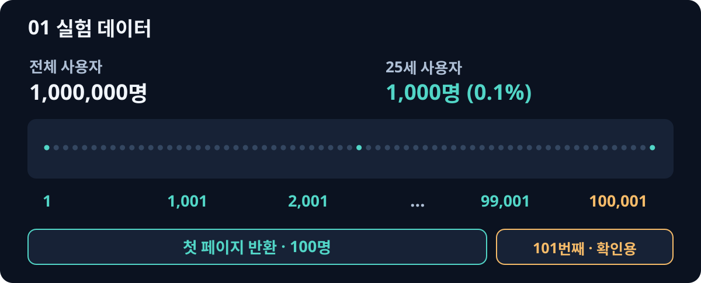
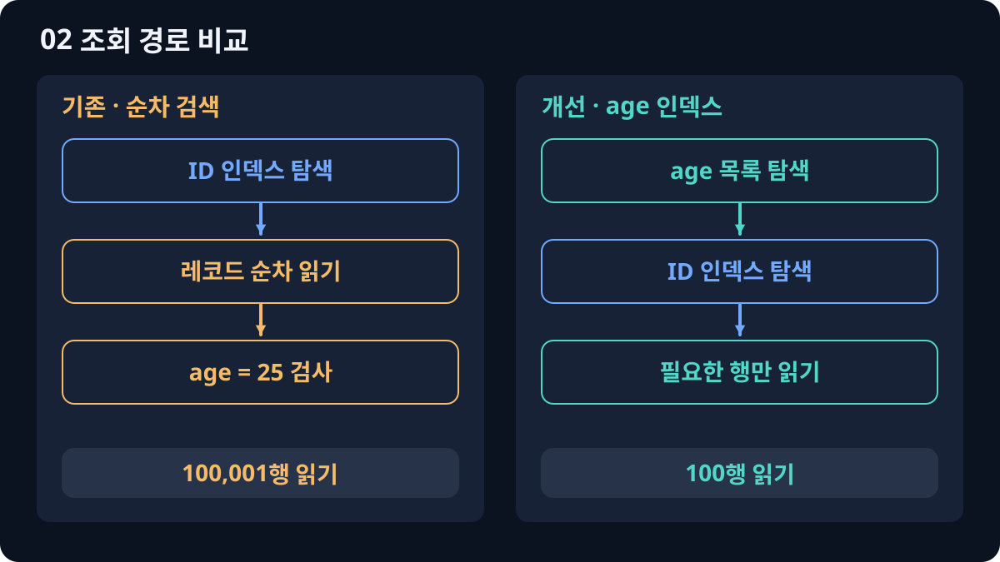
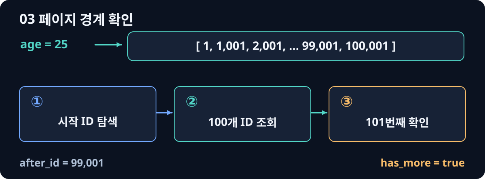
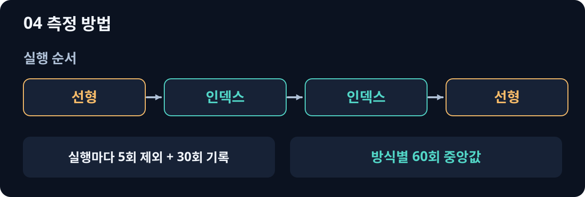
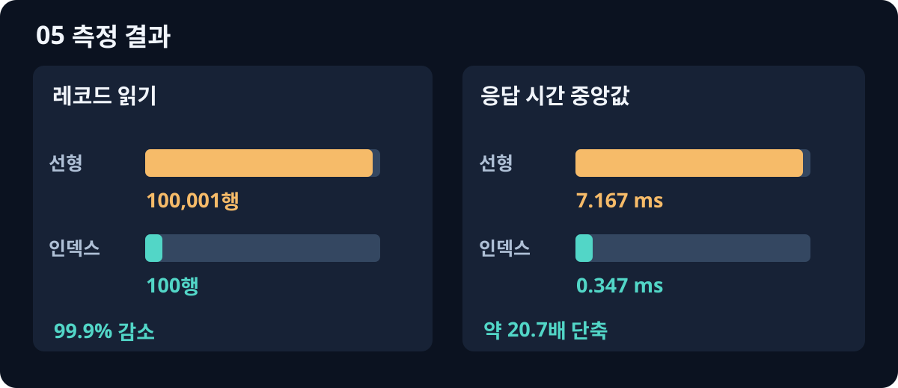

# miniDBMS | age 조건 조회 최적화

**ID 기반 순차 조회에서 age 보조 인덱스 조회로 변경**

| 조회 대상 | 기존 방식 | age 인덱스 |
|---|---:|---:|
| 레코드 읽기 | **100,001건** | **100건** |
| 응답 시간 중앙값 | **7.167ms** | **0.347ms** |

> **실험 범위** · 사용자 100만 명 / 25세 1,000명(0.1%) / 첫 페이지 100명 / 방식별 요청 60회

## 01. 문제 | ID 인덱스 기반 조건 검색의 한계

```http
GET /users?age=25&after_id=0&limit=100
```

- **기존 인덱스:** `ID → 파일 위치`를 관리하는 B+ 트리
- **조회 조건:** `age=25`를 만족하는 사용자 100명, ID 오름차순
- **기존 처리:** ID 인덱스에는 age 값이 없어 레코드 읽기 및 조건 검사 필요

- **데이터 분포:** 25세 사용자 1,000명(전체의 0.1%), 1,000행 간격으로 배치
- **조회 범위:** 100명 반환 및 다음 페이지 확인에 **100,001행 검사** 필요



## 02. 개선 | age 보조 인덱스 기반 조회

**인덱스 구조:** `age → ID 오름차순 목록` (논리적 표현)

```text
25 → [1, 1001, 2001, …, 99001, 100001, …]
```



| 순서 | age 인덱스 조회 |
|---|---|
| ① 시작점 탐색 | `after_id`보다 큰 첫 ID를 **이진 탐색** |
| ② 레코드 조회 | 대상 ID **100개** 선정 → 기존 B+ 트리에서 파일 위치 검색 |
| ③ 페이지 여부 | **101번째 ID 존재 여부** 확인 → `has_more=true` |



**응답 동일성:** 기존 방식과 반환 결과 일치. 다음 페이지 커서: `after_id=99001`.

## 03. 측정 | 동일 조건에서 조회 경로 비교



| 항목 | 실험 조건 |
|---|---|
| 비교 | 동일한 실행 파일·데이터·HTTP 요청, `--age-path`로 방식 변경 |
| 실행 순서 | **선형 → 인덱스 → 인덱스 → 선형** |
| 측정 | 실행당 35회 요청, 앞 5회 제외 · 방식별 **60회** 중앙값 |
| 정확성 | 응답 본문 **바이트 단위 일치**, 계측값 자동 검증 |
| 환경 | Docker Desktop(WSL2), `gcc:13`, 동일 컨테이너에서 서버·측정 도구 실행 |

## 04. 결과 | 레코드 읽기 99.9% 감소



| 측정 지표 | 선형 탐색 | age 인덱스 |
|---|---:|---:|
| 반환 사용자 | 100명 | 100명 |
| `has_more` | `true` | `true` |
| 레코드 읽기 | **100,001건** | **100건** |
| 목록에서 확인한 ID | 0개 | 101개 |
| 응답 시간 중앙값 | **7.167ms** | **0.347ms** |

- **레코드 읽기:** **100,001 → 100건** (약 99.9% 감소)
- **응답 시간:** **7.167 → 0.347ms** (약 20.7배 개선, 중앙값 기준)
- **결과 검증:** 응답 본문 일치, 자동 검사 통과

**측정 해석:** 레코드 읽기 횟수 ≠ 물리 디스크 I/O 횟수. HTTP 처리·B+ 트리 탐색·캐시 등은 응답 시간에 영향을 줄 수 있으며, 요인별 기여도는 미측정.

## 05. 인덱스 유지와 조회 개선


| 구분 | 변경 사항 |
|---|---|
| 메모리 | 나이별 사용자 ID 목록 유지 |
| INSERT | 해당 age 목록에 신규 ID 반영 |
| 서버 시작·파일 재작성 | age 목록 구축·재구축 |

**적용 결과:** 기존 ID B+ 트리를 재사용하면서 age 인덱스를 추가해, **25세 사용자가 0.1%인 조건에서 불필요한 레코드 읽기를 99.9% 줄이고 응답 시간 중앙값을 약 20.7배 개선**했다.

<details>
<summary><strong>실험 범위 및 추가 측정 항목</strong></summary>

- 측정 대상: 25세 사용자가 전체의 0.1%인 데이터의 첫 페이지 조회
- 별도 측정하지 않은 항목: INSERT 성능, 인덱스 구축 시간, 메모리 사용량, 다른 age 분포 및 후속 페이지
- 설계 비교 범위: 기존 ID B+ 트리를 재사용했으며 `(age, id)` 복합 인덱스와의 성능 비교는 진행하지 않음

</details>

---

<details>
<summary><strong>보충 | 조회 절차·복잡도·경계 조건</strong></summary>

- age별 ID 목록의 정렬 상태에서 `after_id` 초과 첫 위치를 이진 탐색한다. 특정 나이의 사용자 수를 `K`라 하면 시작점 검색은 `O(log K)`.
- 선택한 `L`개 ID를 순회하는 작업은 `O(L)`. ID별 B+ 트리 탐색 비용이 추가되며 일반적인 균형 트리 모델에서는 `O(L log N)`(전체 사용자 수 `N`).
- `has_more`는 101번째 ID의 **존재**로 판단하고 해당 레코드는 파일에서 읽지 않는다.
- `after_id`는 키 기반 페이지네이션 커서다. 요청 사이에 데이터가 바뀌는 경우 전체 조회에 대한 단일 스냅샷을 보장하지 않는다.
- 추가로 확인할 경계 조건: 일치 결과 0건·정확히 100건·101건, 존재하지 않는 `after_id`, 마지막 페이지. **이 항목들의 테스트 통과 여부는 확인되지 않았다.**
- 논리 구조는 정렬된 ID 목록으로 설명했다. 실제 메모리 레이아웃, 갱신의 원자성 및 계측 함수 위치는 구현 코드 확인이 필요하다.

</details>

<details>
<summary><strong>보충 | 실행별 수치 및 재현 명령</strong></summary>

**측정일:** 2026-11-18 · **연결:** 요청마다 신규 연결 · **집계:** 방식별 60개 원본 응답 시간의 중앙값

| 실행 | 조회 방식 | 레코드 읽기 | 목록 확인 ID | 응답 시간 중앙값 |
|---|---|---:|---:|---:|
| 1 | 선형 | 100,001 | 0 | 6.770ms |
| 2 | age 인덱스 | 100 | 101 | 0.396ms |
| 3 | age 인덱스 | 100 | 101 | 0.280ms |
| 4 | 선형 | 100,001 | 0 | 8.686ms |

Docker Desktop 실행 후 저장소 루트 Git Bash에서 실행:

```bash
revision=$(git rev-parse --short HEAD)
MSYS_NO_PATHCONV=1 docker run --rm -v "$(pwd -W)":/src:ro gcc:13 bash -c '
  set -eo pipefail
  mkdir /w
  cd /src
  tar --exclude=./build --exclude=./data --exclude=./.git -cf - . | tar -xf - -C /w
  cd /w
  make age-bench AGE_COMMIT="$1"
' bash "$revision"
```

검증을 통과하면 마지막 줄에 `확인: 통과`가 출력된다. `AGE_COMMIT`은 **표시용**이고 실제 빌드에는 **현재 작업 트리**가 사용된다. 워밍업 5회 제외는 OS 캐시 등 환경 요인을 완전히 제거하지 않는다.

</details>
